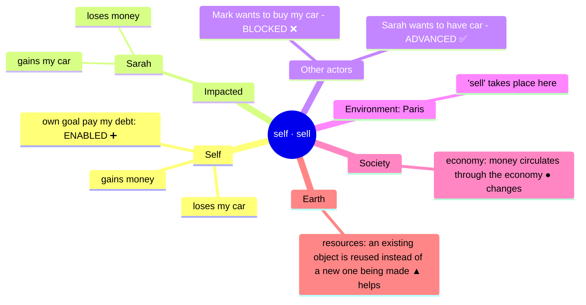
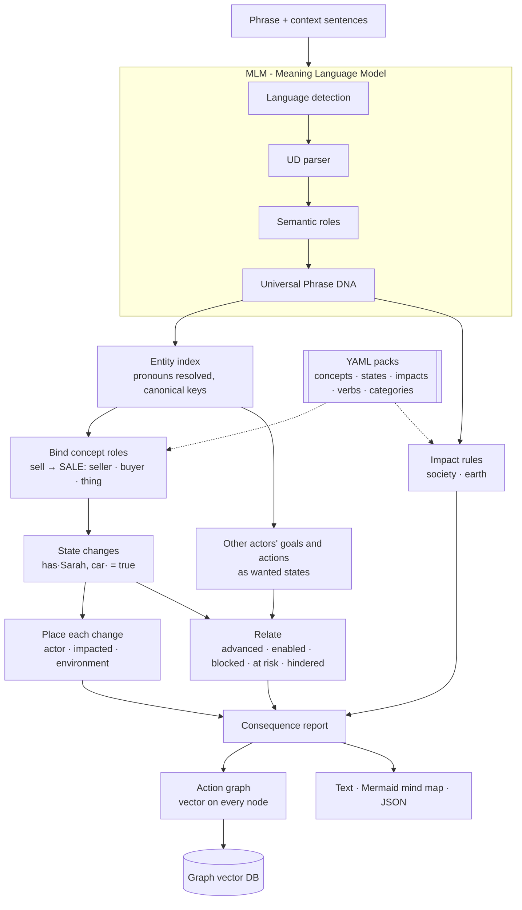
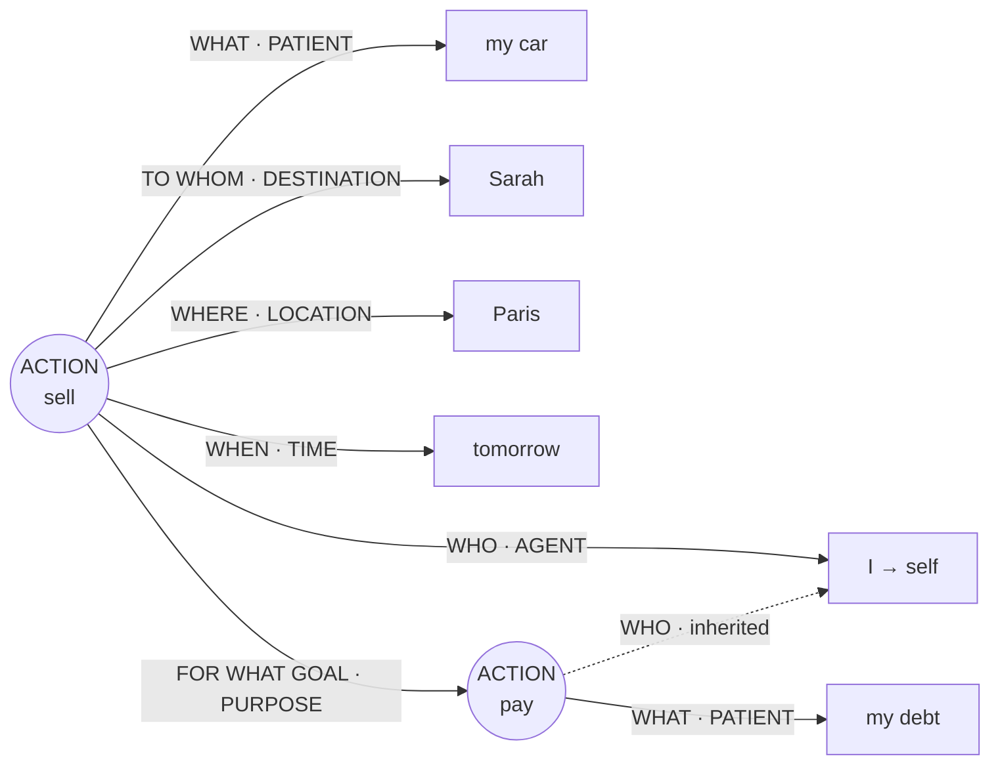
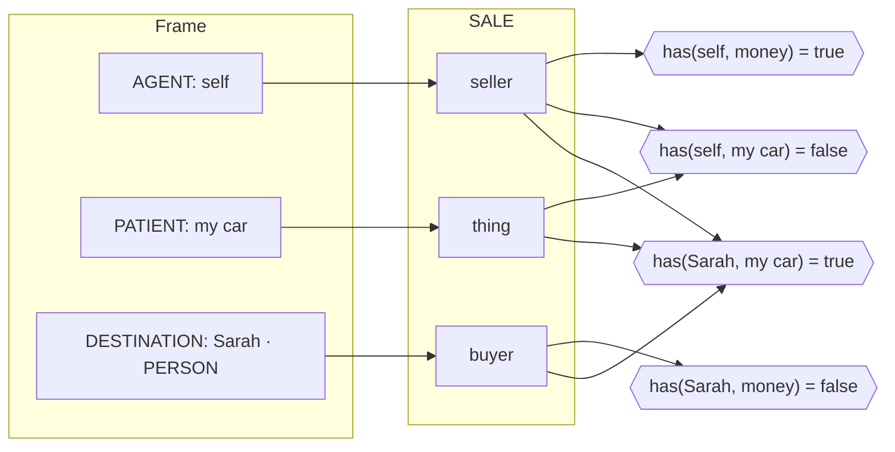
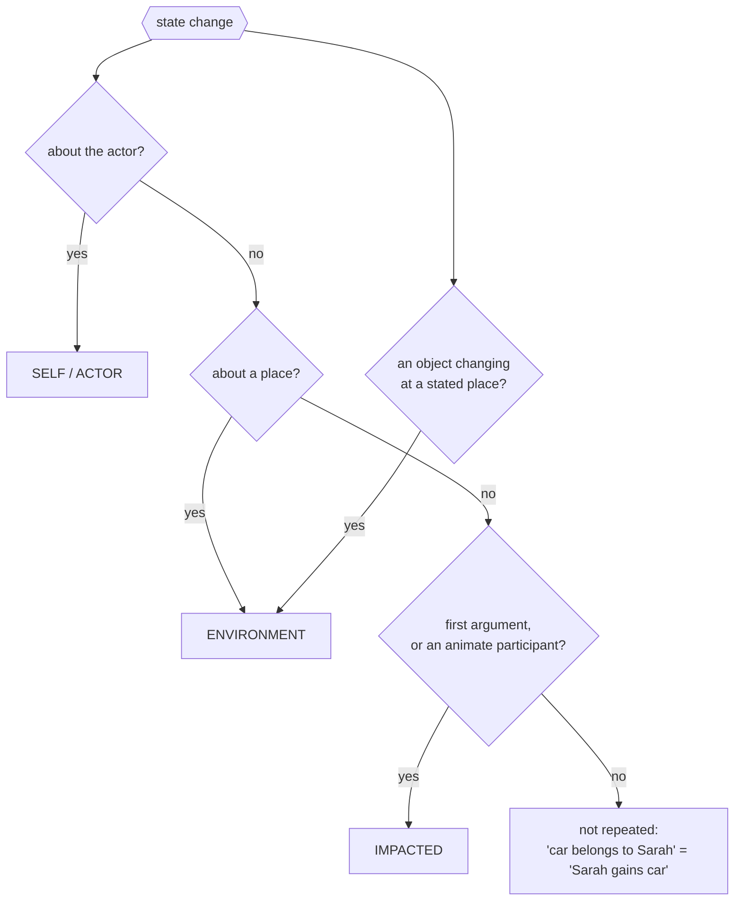
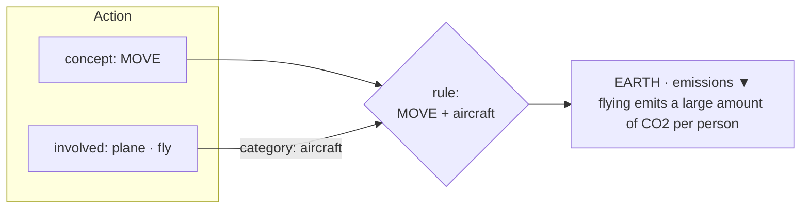
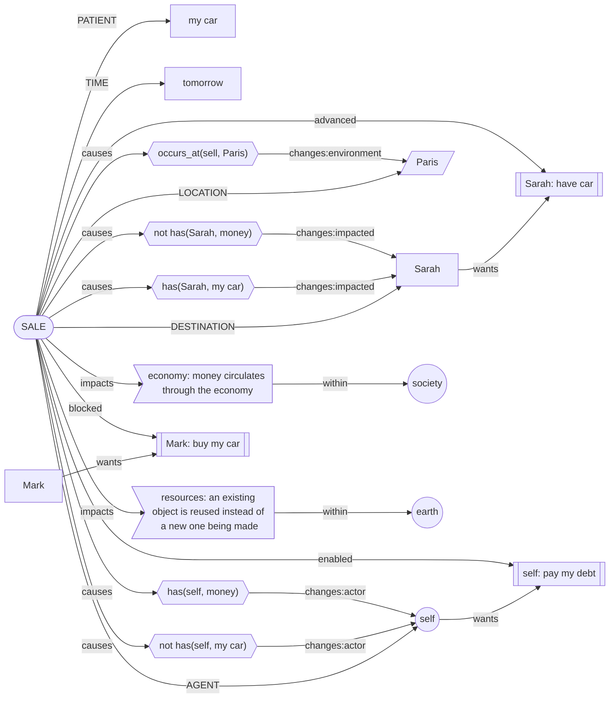
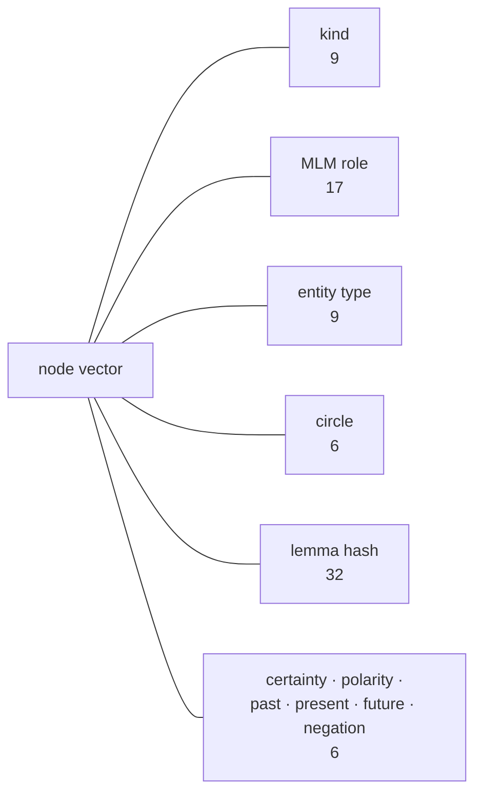
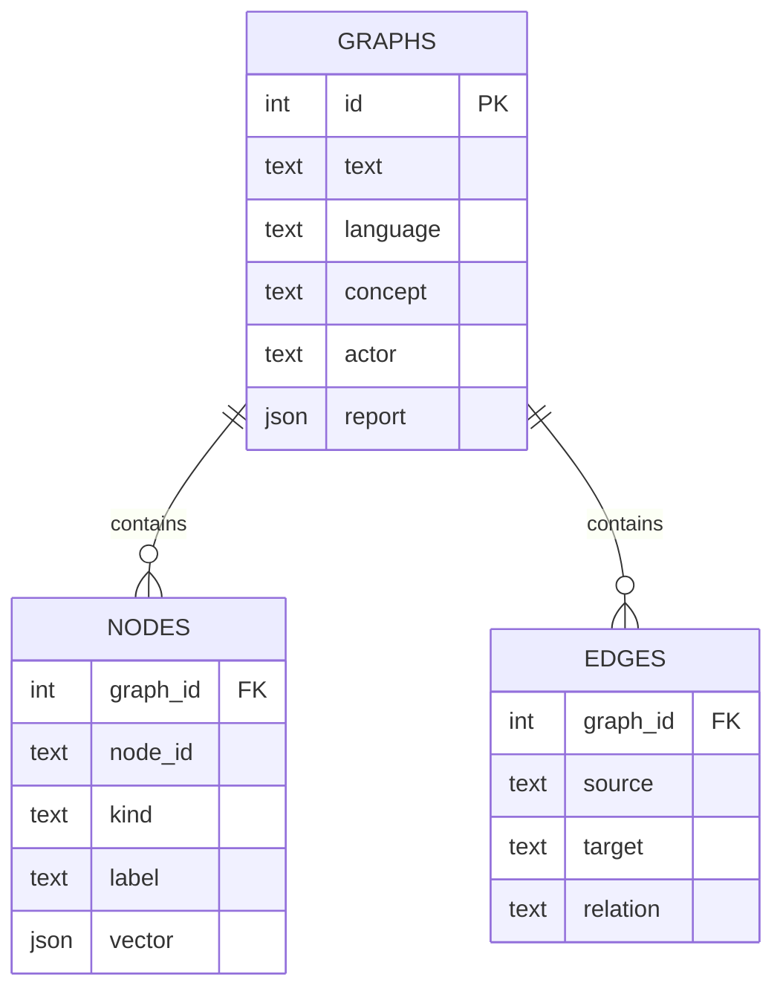
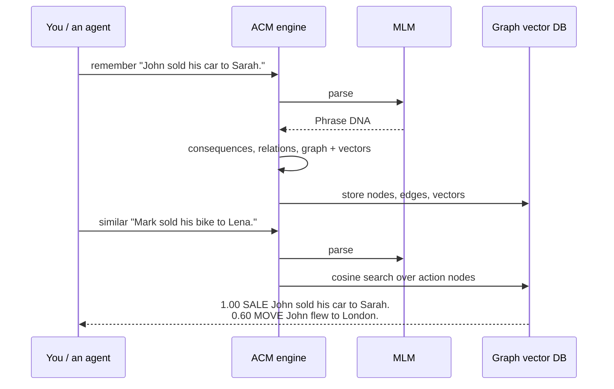

# Actions Consequential Model (ACM)

**See what an action changes before taking it.**

> A language model predicts the next word. MLM first works out what a sentence means.
> **ACM goes one step further: it predicts what an action *does*. It traces the
> consequences for the one acting, for those it lands on, for other actors' goals,
> for the place it happens, for society, and for the earth.**

ACM is built on the [Meaning Language Model (MLM)](https://github.com/Sherlock2019/NPLM-Next-Phrase-language-model-),
which turns a phrase into *Universal Phrase DNA*: who does what, to whom, where,
when, how and why. ACM turns that structure into a graph of the full action in its
context. It predicts the consequences circle by circle, and stores every node as a
vector so it can be compared with past actions. When the actor is **"I"**, the
report is the model's view of its **own** planned action.


*Generated by [`scripts/draw_vision.py`](scripts/draw_vision.py) from a real run:
the MLM parser plus the ACM engine. Nothing is placed by hand. Each ring shows what
ACM's report put there. The coloured strips are the actual node vectors, and the
scores on the right come from a real search of the graph vector store.*

---

## Contents

- [The six circles](#the-six-circles)
- [Quick start](#quick-start)
- [Architecture](#architecture)
- [Step 1 - Phrase DNA from MLM](#step-1---phrase-dna-from-mlm)
- [Step 2 - Concepts and state changes](#step-2---concepts-and-state-changes)
- [Step 3 - Placing each consequence](#step-3---placing-each-consequence)
- [Step 4 - Other actors: goals and actions](#step-4---other-actors-goals-and-actions)
- [Step 5 - Society and earth](#step-5---society-and-earth)
- [Step 6 - The action graph and its vectors](#step-6---the-action-graph-and-its-vectors)
- [Step 7 - The graph vector database](#step-7---the-graph-vector-database)
- [Command line](#command-line)
- [Honesty rules](#honesty-rules)
- [Extending ACM](#extending-acm)
- [Limitations](#limitations)
- [Project layout](#project-layout)

---

## The six circles

| Circle | Question | Example |
|---|---|---|
| **Self / Actor** | What happens to the one acting? | loses the car, gains money |
| **Impacted** | What happens to WHAT / TO WHOM? | Sarah gains the car |
| **Other actors** | Does it help or block their goals and actions? | Mark's goal "buy the car" is blocked |
| **Environment** | What changes WHERE it happens? | the database no longer exists in production |
| **Society** | Economy, law, trust, public services | money circulates through the economy |
| **Earth** | Emissions, biodiversity, resources, waste | flying emits CO2 |

The same report as a mind map, exactly as `acm predict --format mermaid` prints it
for the scenario in the image:



---

## Quick start

ACM needs MLM in the same Python environment. Clone both side by side:

```bash
git clone git@github.com:Sherlock2019/NPLM-Next-Phrase-language-model-.git SLM
git clone git@github.com:Sherlock2019/ACM.git
cd ACM
python -m venv .venv && source .venv/bin/activate
pip install -e ../SLM -e ".[dev]"
pytest                                   # 30 tests, no parser model needed
```

To analyse new text, also install MLM's parser:

```bash
pip install -e "../SLM[parse]"
python ../SLM/scripts/download_resources.py
```

```bash
python -m acm.cli predict "I will sell my car to Sarah in Paris tomorrow to pay my debt." \
    --context "Mark wants to buy my car." --context "Sarah needs a car."
```

```
ACTION  I will sell my car to Sarah in Paris tomorrow to pay my debt.
        concept=SALE  tense=future  certainty=0.90  SELF-VIEW

ACTOR  (self) self
  loses my car
  gains money
  own goal 'pay my debt': ENABLED ➕ - provides what it needs: self has money

IMPACTED
  Sarah: gains my car; loses money

OTHER ACTORS
  Mark wants to buy my car - BLOCKED ❌  (Sarah has my car, so 'Mark has my car' cannot hold)
  Sarah wants to have car - ADVANCED ✅  (makes 'Sarah has car' true)

ENVIRONMENT  Paris
  Paris: 'sell' takes place here

SOCIETY
  economy: money circulates through the economy (● changes)

EARTH
  resources: an existing object is reused instead of a new one being made (▲ helps)
```

The last sentence is the action. Earlier sentences, or `--context`, supply the
world it happens in: other actors' goals ("Mark wants to...", "Sarah needs...") and
their actions ("Mark bought a car").

---

## Architecture



| Layer | Answers | Module | Knowledge |
|---|---|---|---|
| Phrase DNA | Who does what, to whom, where, when, why? | MLM (`splm`) | MLM language packs |
| Entity index | Which mentions are the same entity? | `acm/entities.py` | MLM context graph |
| Binding | Which element plays which part in the action? | `acm/engine.py` | `packs/universal/concepts.yaml`, `packs/<lang>/actions.yaml` |
| State changes | What becomes true or false? | `acm/engine.py` | `packs/universal/states.yaml` |
| Relations | Does that help or block others? | `acm/engine.py` | state exclusivity, concept `requires` |
| Impacts | What does it do to society and the earth? | `acm/engine.py` | `packs/universal/impacts.yaml`, `packs/<lang>/categories.yaml` |
| Graph | How does it all connect, as vectors? | `acm/graph.py` | MLM role inventory |
| Store | What have we seen before that looks like this? | `acm/store.py` | SQLite |
| Output | How do we show it? | `acm/render.py`, `acm/cli.py` | - |

As in MLM, **no linguistic or world facts live in Python**. Which verb is a sale,
what a sale changes, which states are exclusive and what flying does to the
climate are all YAML under [`packs/`](packs/).

---

## Step 1 - Phrase DNA from MLM

MLM turns each sentence into a language-independent frame. Frames nest: a purpose
or a condition becomes its own frame.



`tense=future  modality=intention  certainty=0.90`. The nested *pay* frame has no
subject of its own, so ACM gives it the outer actor: the debt being paid is the
actor's own.

---

## Step 2 - Concepts and state changes

Verbs map onto universal **concepts**, so *sell*, *vendre* and *bán* all reach
`SALE`. A concept says which frame roles fill its parts, what it changes, and what
it requires:

```yaml
SALE:
  roles:
    seller: [AGENT]
    buyer:  [RECIPIENT, BENEFICIARY, DESTINATION@PERSON, DESTINATION@ORG]
    thing:  [PATIENT, THEME, OBJECT]
  effects:
    - { state: has, args: [buyer, thing], primary: true }   # the intended outcome
    - { state: has, args: [seller, thing], value: false }
    - { state: has, args: [seller, =money] }
    - { state: has, args: [buyer, =money], value: false }
  requires:
    - { state: has, args: [seller, thing] }
```



Every consequence is written in a small **state vocabulary**
([`states.yaml`](packs/universal/states.yaml)): `has`, `at`, `exists`, `owes`,
`knows`, `met`, `won`, `damaged`, `helped`. Some states are **exclusive**: a thing
has one owner at a time, an entity is in one place at a time, and a contest has
one winner. Exclusivity is what lets ACM see conflicts between actors.

There are 15 concepts: SALE, PURCHASE, GIFT, THEFT, PAYMENT, MOVE, DEPART, MEET,
DESTROY, CREATE, DEPLOY, INFORM, WIN, DAMAGE and HELP.

---

## Step 3 - Placing each consequence

Each state change is reported under the entity it is about:



Examples from the tests:

| Action | Actor | Impacted | Environment |
|---|---|---|---|
| *The engineer deleted the database in production.* | - | database: no longer exists | production: database no longer exists |
| *John flew to London.* | is now in London | - | London: John arrives |
| *John owns a car. He sold it to Sarah.* | loses car, gains money | Sarah: gains car, loses money | - |

---

## Step 4 - Other actors: goals and actions

Context sentences become **intentions**, written in the same states as the
consequences, which makes them comparable:

| Context | Intention | Wanted / achieved state | Needs |
|---|---|---|---|
| *Mark wants to buy my car.* | goal | `has(Mark, car)` | `has(Mark, money)` |
| *Sarah needs a car.* | goal | `has(Sarah, car)` | - |
| *Mark bought a car.* | action | `has(Mark, car)` | - |
| *... to pay my debt* (in the action itself) | own goal | `owes(self, debt) = false` | `has(self, money)` |

Each intention is then compared with the action's consequences:


| Context | Action | Relation |
|---|---|---|
| Mark wants to buy John's car. | John will sell his car **to Sarah**. | Mark: **BLOCKED** - Sarah has the car |
| Mark wants to buy John's car. | John sold his car. *(buyer unnamed)* | Mark: **AT RISK** |
| Mark wants to buy John's car. | John **did not** sell his car to Sarah. | Mark: **UNAFFECTED** |
| Sarah needs a car. | John sold his car to Sarah. | Sarah: **ADVANCED** |
| Mark hopes to win the race. | Sarah won the race. | Mark: **BLOCKED** |
| Mark bought a car. | John stole the car. | Mark's action: **UNDOES** |
| *(own purpose)* ... to pay his debt | John will sell his car. | own goal: **ENABLED** - John gains money |
| Mark wants to buy John's car. | John kicked the ball. *(verb unknown)* | Mark: **NO EVIDENCE** |

---

## Step 5 - Society and earth

Wider impacts come from rules in [`impacts.yaml`](packs/universal/impacts.yaml).
A rule fires when the action's concept matches and something involved belongs to
a listed category ([`categories.yaml`](packs/en/categories.yaml)): an argument, an
instrument, a means of transport, or the verb itself.



| Action | Society | Earth |
|---|---|---|
| *John flew to London.* | - | emissions ▼ |
| *John traveled to Paris by train.* | - | emissions ▲ (low-carbon) |
| *The company destroyed the forest.* | - | biodiversity ▼ |
| *John will sell his car to Sarah.* | economy ● | resources ▲ (reuse) |
| *John stole the car.* | law ▼ | - |
| *The engineer deleted the database in production.* | data ▼ | - |
| *John kicked the ball.* | no known impact | no known impact |

"No known impact" means no rule matched. **It is never reported as "no impact".**

---

## Step 6 - The action graph and its vectors

Everything above becomes one graph per action. This is the real graph for the
scenario in the image, exactly as `acm graph` prints it:



| Shape | Node kind |
|---|---|
| `([ ])` stadium | action |
| `(( ))` circle | self, society, earth |
| `[ ]` rectangle | entity, time |
| `[/ /]` parallelogram | place |
| `{{ }}` hexagon | state change |
| `> ]` flag | society / earth impact |
| `[[ ]]` subroutine | another actor's goal or action |

**Every node carries a 79-dimensional vector.** The dimensions are built from MLM's
role and entity-type inventories, so they grow if those do:



The default `HashingEmbedder` is **structural**. Two nodes are close when they play
the same part in similar actions: *John sold his car to Sarah* and *He sold it to
Sarah* score 1.00. *Car* and *vehicle*, however, are as unrelated as *car* and
*Paris*. A learned embedder can replace it behind the same `embed()` interface.

---

## Step 7 - The graph vector database

`GraphVectorStore` keeps every analysed action in SQLite and searches its vectors
by cosine similarity:





Queries available: `search(vector, kind=...)`, `similar_actions(report)`,
`history(entity)` (everything that ever happened to Sarah) and `stats()`. Search
is exact numpy cosine, which is fine for thousands of nodes. FAISS or pgvector is
the upgrade path behind the same methods.

---

## Command line

```bash
acm predict  "..." [--context "..."]... [--format text|mermaid|json]
acm graph    "..."                      # the vector graph as a Mermaid flowchart
acm remember "..." [--db data/acm.db]   # store the graph
acm similar  "..." [--db data/acm.db]   # nearest stored actions
```

(`acm` is installed as a script; `python -m acm.cli` works too.)

Python:

```python
from acm import ConsequenceEngine, Target
from acm.render import to_mindmap

engine = ConsequenceEngine()
report = engine.analyze("I will sell my car to Sarah.", context=["Mark wants to buy my car."])
report.for_target(Target.IMPACTED)      # consequences per circle
report.other_relations()                # Mark: BLOCKED
print(to_mindmap(report))
```

---

## Honesty rules

These carry over from MLM and are enforced in code and tests:

- **An unknown verb gets no verdict.** If ACM has no concept for a verb, its
  consequences are generic and marked uninformative, and every goal relation is
  *no evidence*, never *unaffected*.
- **No rule is not no impact.** When no society or earth rule fires, the output
  says so explicitly.
- **Negation and conditions count.** A negated action changes nothing. A
  conditional one states its condition and has lower certainty (×0.6).
- **Certainty is reported.** Past actions score 1.0 and planned ones 0.8–0.9, or
  whatever MLM's modality analysis gives.
- **An unnamed participant is never assumed.** "John sold his car" puts Mark's goal
  *at risk*, not *blocked*.
- **Vectors are described as what they are:** structural, not semantic.

---

## Extending ACM

**A verb:** add `lemma: CONCEPT` to `packs/<lang>/actions.yaml`.

**A concept:** add roles, effects and requires to
`packs/universal/concepts.yaml`. The loader rejects unknown states, wrong
argument counts and unknown roles.

**An impact:** add a rule to `packs/universal/impacts.yaml` and, if needed, words
to `packs/<lang>/categories.yaml`.

**A language:** add `packs/<lang>/actions.yaml` (verbs plus goal markers) and
`categories.yaml`. MLM must support the language.

**A learned embedder:** implement `embed(**features) -> list[float]` with a `dim`
attribute and pass it as `ConsequenceEngine(embedder=...)`.

---

## Limitations

- **Seed knowledge.** There are 15 concepts, about 40 English verbs (fewer in French
  and Vietnamese) and about 20 impact rules. Anything outside them falls back to
  generic consequences.
- **Entity identity is coarse.** Common nouns are keyed by head lemma, so "John's
  car" and "his car" match, but two different cars would also match.
- **Society and earth impacts are rules, not models.** They show the mechanism,
  not a full footprint.
- **MLM's parse errors propagate.** For example, French *à Sarah* is read as a
  location.
- **Explanations are rendered in English only;** the reasoning is
  language-independent.
- **No learned components yet.** Consequences, relations and embeddings are
  rule-based or structural. They are the baseline a trained version must beat.

---

## Tests and scripts

```bash
pytest                              # 30 tests over committed CoNLL-U fixtures
python scripts/make_fixtures.py     # regenerate fixtures (needs MLM's parser); review the diff
python scripts/draw_vision.py       # regenerate docs/acm-vision.svg from a real run
```

## Project layout

```
ACM/
  packs/universal/   states, concepts, impacts, settings
  packs/<lang>/      actions (verb → concept, goal markers), categories
  src/acm/           engine, entities, graph (vectors), store, render, cli
  scripts/           make_fixtures.py, draw_vision.py
  tests/             30 tests over committed fixtures
  docs/              acm-vision.svg / .png
```

## Licence

MIT. MLM is a separate project under its own MIT licence.
