#  The Butterfly Model: the Action–Worlds Consequence prediction Model (ACM)

**See what an action changes before taking it.**

*About the name: the project started as ACM (Actions Consequential Model) and was
called ARM (Action Reaction Model) for a while in the dashboard, then the Action–Consequence Model. It is now **the Butterfly Model: ACM, the
Action–Worlds Consequence prediction Model**, everywhere in the user interface. The butterfly is for the butterfly effect: one actor, one action, consequences in cascade across every world. Only the user-facing name
changed. The repository, the Python package, the `acm` command, the `/acm/...` routes
and the `ACM_LLM_*` environment variables kept their names throughout.*

| | |
|---|---|
| [**What**](#what-acm-is) | a model of what an action *does*: an eight-layer world model, from the physical world to the planet |
| [**Why**](#why-acm-exists-what-an-llm-cannot-do) | an LLM predicts words, not world states, and cannot show why it says what it says |
| [**How**](#how-it-works) | the action is perceived, routed to the world layers that should examine it, and each layer reports its consequences with evidence |
| [**So what**](#so-what-acm-compared-with-llm-mode) | explicit, inspectable, repeatable consequences that say when they do not know |
| [**What next**](#what-next) | a real model behind every layer: 3D physics, perception, institutions, economy, planet |

---

## What ACM is

> A language model predicts the next word. MLM, the
> [Meaning Language Model](https://github.com/Sherlock2019/NPLM-Next-Phrase-language-model-),
> first works out what a sentence means. **ACM goes one step further: it predicts what an
> action *does*:** what it changes, for whom, in which systems, and how far it reaches.

ACM sees the world as a **stack of layers above every action**, read bottom-up like the OSI
network model it borrows its shape from. An action happens in the physical world and is
perceived. A **consequence router** decides which world models, actors and systems should
examine it. Each layer above the router has its own kind of model.

**Each world follows its own laws.** ACM predicts the consequence of an action separately
in each world, by that world's laws: physical laws in the physical world, behavioural and
psychological laws for people and animals, economic laws in the economy, and so on up to
the laws of the earth.

<p align="center">
  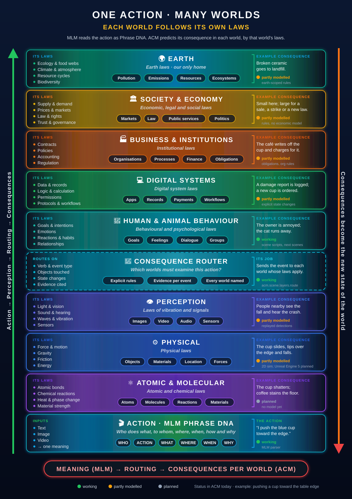
</p>

| Level | Layer | Its laws | What it examines |
|---:|---|---|---|
| 8 | 🌍 Planetary and ecosystem | **Earth laws:** ecology, climate, resource cycles, biodiversity | Resources, pollution, biodiversity and sustainability |
| 7 | 🏛️ Society and collective systems | **Economic, legal and social laws:** supply and demand, prices, law, trust, governance | Economy, markets, society, public governance and politics |
| 6 | 🏭 Business and institutions | **Institutional laws:** contracts, policies, accounting, regulation | Organisations, operations, processes, finance and policies |
| 5 | 💻 Digital and information systems | **Digital system laws:** data, logic, permissions, protocols, workflows | Applications, records, calculations, permissions and workflows |
| 4 | 🧠 Human and social | **Behavioural and psychological laws** of humans and animals: goals, emotions, reactions, relationships | Goals, behaviour, dialogue, relationships and group reactions |
| 3 | 🧭 **Consequence routing** | No laws of its own: sends each event to the worlds whose laws apply | Which world models, actors and systems should examine an event |
| 2 | 👁️ Perception and observation | **Laws of vibration and signals:** light, sound, waves, sensing | Images, video, audio, speech, sensors and observations |
| 1 | ⚙️ Physical world | **Physical laws:** force, motion, gravity, friction, energy. At the atomic scale: **atomic and chemical laws** (bonds, reactions, heat) | Objects, materials, movement, forces, location and energy |
| Source | 🎬 Action or event | The cause: an actor, their goal and the action, parsed by MLM into Phrase DNA | Who acts, why, their goal and desired outcome, and what happens |

The atomic and molecular world is shown as its own band in the diagram but sits inside
level 1 in the code; it has no model yet.

Every consequence ACM reports sits on **two axes**:

- its **layer**: *which kind of system* it is about, and so which model examines it;
- its **ring** (scope) in the [blast radius](#the-blast-radius): *how far* it reaches, from
  the actor and the other participants out to the city, society, the economy and the world.

**Consequences cross worlds.** A consequence in one world has consequences in the other
worlds, in two ways:

- **By proximity (⇅).** It ripples into neighbouring worlds and nearby actors. The cup
  falls (physical), people hear the crash (perception), the owner is annoyed (behaviour),
  a damage report is logged (digital), and the café writes off the cup (business).
- **By synchronicity (∿).** Worlds change together, at the same moment, down to the
  quantum level, so a change in one world is matched by a change in another even when
  no visible chain of cause links them.

At the quantum level, changing together is correlation, not a signal: entangled systems
stay correlated but cannot carry cause and effect between them. So a synchronous link
would mark two consequences as *correlated*, never as one *causing* the other.

This is a concept, not yet modelled. Today a consequence that cites an event routes that
event to its layer, but ACM does not yet propagate a consequence from one world into the
others.

ACM has two engines that share this model and the same honesty rules:

| Engine | Input | What it does | Where |
|---|---|---|---|
| **Scene engine** | a situation as a structured script: people, goals, objects, actions, dialogue | builds the scene state event by event, routes each event to the world layers, shows the consequences per layer and per ring, offers possible next scenes, exports scene directions | [`src/acm/scene/`](src/acm/scene/), [`scenes/`](scenes/), dashboard `/acm/scenario` |
| **Rule engine** | one action sentence (+ context sentences) | parses it with MLM and predicts its consequences from YAML rule packs, ring by ring | [`src/acm/engine.py`](src/acm/engine.py), [`packs/`](packs/), dashboard `/acm` |

When the actor is **"I"**, the report is the model's view of its **own** planned action:
ACM becomes a check an agent can run before it acts.

[](docs/acm-vision.svg)

**[⛶ Open the radar full screen](docs/acm-vision.svg)** (click the image too; it stays animated).

*The rings are the eight worlds, from the centre out in the same order as the
[world-layers stack](docs/world-layers.svg): atomic, physical, perception, human and animal
behaviour, digital, business, society and economy, earth. Animated: the origin actor (red dummy) acts; its action (red vectors) reaches the other
actors in the same space (blue dummies), whose reactions (blue vectors) carry the
consequence onward; and the impact spreads outward world by world by proximity, each ring
lighting up as the wave reaches it. A reaction here is the consequence for that actor's
goal (advanced, blocked), computed by the engine; what they do next is not predicted. Generated by
[`scripts/draw_vision.py`](scripts/draw_vision.py) from a real run of the rule engine: the
MLM parser plus the ACM engine, nothing placed by hand. The rule engine places each
consequence on a ring; the world named on each ring is an explicit mapping for the picture.
A still version is in [`docs/acm-vision.png`](docs/acm-vision.png).*

---

## Why ACM exists: what an LLM cannot do

A large language model is trained to continue text. That makes it fluent, but an
agent that acts in the world needs to know what its actions **change**, and an LLM
has these limits by design:

| LLM limitation | What goes wrong |
|---|---|
| **It predicts words, not world states** | Nothing inside it records that the car now belongs to Sarah, so the next sentence can still give it to Mark. |
| **Fluent is not the same as grounded** | A plausible answer and a correct one look identical. The model cannot point at the rule or observation behind a claim. |
| **It never says "I don't know"** | Gaps are filled with the most likely words. A missing cause becomes an invented one, and an unknown verb still gets a confident verdict. |
| **Same question, different answers** | Sampling changes the outcome. Three runs of one prompt can disagree about who ends up with the car. |
| **No physics** | Whether a pushed mug falls depends on mass, friction and distance to the edge. The model never simulates them. |
| **One undifferentiated view** | Physics, people, records, institutions and the economy are all just text to it; nothing decides which of them an action actually touches. |
| **The view stops at the people mentioned** | Neighbours, organizations, the country and the earth appear only if the text mentions them. |

A real recording (SmolLM2-135M, local, `examples/llm_baseline.json`, made by
`scripts/make_llm_baseline.py`):

> *Mark wants to buy John's car. Sarah needs a car. John sold his car to Sarah.*
> **What happens next to Mark?**
>
> LLM, greedy: *"Mark buys a car."* · sampled: *"Mark gets a car."* · *"Mary bought a car. Mary sold a car to Mark."*
>
> ACM: **Mark's goal is BLOCKED ❌.** SALE makes `has(Sarah, car)` true; ownership is
> exclusive, so `has(Mark, car)` cannot hold. Sarah's goal is ADVANCED ✅. Basis: rule,
> certainty 1.0.

A small base model makes the failure easy to see. Larger models fail less often, but
in the same way, and the failure is harder to spot.

---

## How it works

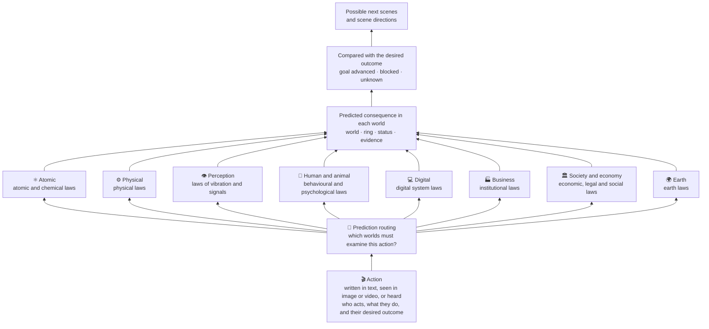

1. **The action and the desired outcome, as data.** The action arrives written in text,
   seen in an image or video, or heard. A scene is a script (`acm.scene/1`): place, time,
   actors with goals (their desired outcomes) and stated positions, objects with owners
   and holders, and ordered events (action, dialogue, observation). A single sentence is
   parsed by MLM into the same who · does what · to whom · where · when · why.
2. **Prediction routing: the WHERE of the phrase.** Routing starts from the world the
   action itself happens in, which is the WHERE of its Phrase DNA: throw a ball *in the
   park* (physical), send a message *on Facebook*, post an image or send an email
   (digital), buy something *at a shop* (economy), stream or post *on a platform* (media),
   vote *at the polls* or protest *in the street* (politics, in society). Routing by the
   WHERE is the design; today the consequence router (`acm.scene.layers.route`) decides
   from each event's verb, type, objects and effects. It sends every
   event to the worlds, people and objects that should examine it, and lists the rule that
   fired: dialogue goes to human and social; someone else's property brings its owner in;
   a debt goes to business and digital; a consequence citing the event routes it to that
   world.
3. **Each world predicts by its own laws.** In the physical world, each event's effects
   (`keys.holder = mark`) update the scene state, so ACM knows what is true before and
   after every step: in the Car Sale, the sale ends *disputed*, the car is still Sarah's
   and the debt is unpaid. In perception, ACM tracks who could see or hear each event:
   Florence hears Sarah's objection, so her next question follows from what she perceived.
   The worlds above apply their own laws in the same way.
4. **Compared with the desired outcome.** Each actor's goal is checked against the
   predicted state: Mark's goal is *blocked*, Sarah's is *advanced*. ACM shows whether the
   action gets the actor what they wanted, and what else it changes.
5. **Each world reports.** Consequences carry their world layer, their ring, a status (`stated` ·
   `possible` · `unknown` · `not identified`), the events that support them, and a source
   (`scenario fact` · `authored demo` · `generated inference`). Feelings and thoughts are
   only ever *possible*. A layer with nothing identified says so, never "no impact".
6. **Next scenes.** Branches continue the scene under stated assumptions, from authored
   demo content or the local model (validated, labelled, never given probabilities), and
   play from the state where the scene ended.
7. **Directions out.** The selected scene is exported as `acm.directions/1` for the 2D
   player today and a 3D engine, physics and text-to-speech later.

The rule engine follows the same path for one sentence: Phrase DNA → concepts and state
changes → who it lands on → other actors' goals → the blast radius from scoped impact rules →
a graph with vectors in a searchable store. A local LLM only *phrases* ACM's results; it
never decides a consequence. Details: [the world layers](#the-world-layers-eight-layers-above-every-action),
[the scene engine](#the-scene-engine-a-situation-as-a-script), and
[Architecture](#architecture) with Steps 1–9 for the rule engine.

---

## So what: ACM compared with LLM mode

In ACM, **models and rules determine the outcomes and the LLM only explains them**:

| | LLM mode | ACM |
|---|---|---|
| Output | the next likely words | explicit state changes: `has(Sarah, car) = true`, `sale = disputed` |
| Which systems are affected | whatever the text drifts to | a routing table: each event, the layers it goes to, and the rule that sent it there |
| Why it says so | hidden in the weights | every consequence carries its basis, its supporting events and its source |
| Unknowns | filled with plausible text | reported: "not identified" is never "no impact", and unknown places are not guessed |
| Facts vs guesses | blended | stated · possible · unknown, and scenario fact · authored · generated, on every item |
| Other people's goals | often forgotten or contradicted | checked one by one: advanced · enabled · blocked · at risk · hindered |
| Reach | whoever the text mentions | eight world layers × eight rings, from the actor to the world |
| Physical actions | guessed from text | scene state today; simulated in a physics engine using object properties |
| Repeatability | varies with sampling | same input, same report, same certainty |
| Memory | the context window | a graph vector database of every analysed action |
| Changing what it knows | retrain or fine-tune | edit a YAML scene or pack; no Python, no retraining |

**Where an LLM is still better:** breadth (it has seen every verb), fluency, and
always having an answer for an unseen situation. That is why ACM keeps a local LLM
to phrase its answers, read free-form questions and propose next scenes, which are
validated and labelled as generated, but never lets it decide a consequence.

---

## What next

Today ACM is a transparent baseline: the layers that work are the action, routing, and human
and social layers; the others are partly modelled by rules and say so. Each next step puts a
real model behind a layer, measured against that baseline.

| Layer | Today | Next |
|---|---|---|
| ⚙️ 1 Physical world | positions, holders and owners; 2D matter.js stand-in in the physics lab | **Unreal Engine 5 in the loop** (Chaos Physics, Physical Materials, Movie Render Queue) driven by the scene directions, simulated events fed back as state changes; world models (V-JEPA 2-AC) behind the same interface ([docs/world_model_feasibility.md](docs/world_model_feasibility.md)) |
| 👁️ 2 Perception | who sees or hears each event; replayed image and video detections | **real perception**: a vision-language model (Qwen3-VL) and a detector/tracker (YOLO), keeping the no-future-leakage rule |
| 🧭 3 Routing | explicit rules plus cited evidence | more rules per domain, routing of model-generated branches, and a routing benchmark on annotated scenes |
| 🧠 4 Human and social | authored scenes, optional model-generated branches | model-generated analysis (validated like branches), more scenes, people and objects together (a worker reacting to a falling box) |
| 💻 5 Digital | explicit state changes and amounts | sandboxed models of real systems (registries, ledgers, permissions): run the change, compare records before and after |
| 🏭 6 Business | obligations in the scene, organisation impact rules | process and policy models, contract and jurisdiction rule packs |
| 🏛️ 7 Society | society and country impact rules | economic and political models (econometrics, agent-based, historical analogues), always labelled with their uncertainty |
| 🌍 8 Planetary | earth impact rules | resource and emission models |

Across all layers:

1. **Layers that talk to each other.** Each layer reads state changes and writes new events
   back; the router runs until nothing changes or a time horizon is reached. Certainty can
   only drop from one hop to the next, and each layer keeps its own clock (physics in
   milliseconds, people in minutes, institutions in days, the economy in months).
2. **Bigger knowledge packs.** More concepts, verbs, impact rules, places and languages;
   each is a YAML edit.
3. **Learned components that beat the baseline.** A learned embedder, then trained
   consequence models, scored on the inference suite against the rules.
4. **An AI checking its own actions.** When the actor is "I", the report is the agent's
   view of its own planned action: see the consequences on every layer, then decide.

---

## Contents

- [What ACM is](#what-acm-is)
- [Why ACM exists: what an LLM cannot do](#why-acm-exists-what-an-llm-cannot-do)
- [How it works](#how-it-works)
- [So what: ACM compared with LLM mode](#so-what-acm-compared-with-llm-mode)
- [What next](#what-next)

- [The scene engine: a situation as a script](#the-scene-engine-a-situation-as-a-script)
  - [The world layers: eight layers above every action](#the-world-layers-eight-layers-above-every-action)
  - [What you can do now](#what-you-can-do-now)
  - [The demo: Mark, Sarah and Florence](#the-demo-mark-sarah-and-florence)
  - [Facts, authored content, inferences and unknowns](#facts-authored-content-inferences-and-unknowns)
  - [Architecture and data flow](#architecture-and-data-flow)
  - [Running the scene demo](#running-the-scene-demo)
  - [The scene schema and adding a scene](#the-scene-schema-and-adding-a-scene)
  - [Demo data vs live generation](#demo-data-vs-live-generation)
  - [3D, physics and audio: what exists and what is planned](#3d-physics-and-audio-what-exists-and-what-is-planned)
  - [Scene engine limitations and troubleshooting](#scene-engine-limitations-and-troubleshooting)
- [The blast radius](#the-blast-radius)
- [Quick start](#quick-start)
- [Architecture](#architecture)
- [Step 1 - Phrase DNA from MLM](#step-1---phrase-dna-from-mlm)
- [Step 2 - Concepts and state changes](#step-2---concepts-and-state-changes)
- [Step 3 - Placing each consequence](#step-3---placing-each-consequence)
- [Step 4 - Other actors: goals and actions](#step-4---other-actors-goals-and-actions)
- [Step 5 - The blast radius: local to earth](#step-5---the-blast-radius-local-to-earth)
- [Step 6 - The action graph and its vectors](#step-6---the-action-graph-and-its-vectors)
- [Step 7 - The graph vector database](#step-7---the-graph-vector-database)
- [Step 8 - Multimodal: text, image and video](#step-8---multimodal-text-image-and-video)
- [Step 9 - The physical world: Unreal Engine 5](#step-9---the-physical-world-unreal-engine-5)
- [Command line](#command-line)
- [Honesty rules](#honesty-rules)
- [Extending ACM](#extending-acm)
- [Limitations](#limitations)
- [Tests and scripts](#tests-and-scripts)
- [Project layout](#project-layout)

---

## The scene engine: a situation as a script

The scene engine represents a situation as a **script**: where and when it happens, who is
there and how they are related, each person's goals and what they know, which objects are
present and who owns or holds them, and an ordered list of actions and dialogue. From that
script it builds the **state of the scene before and after every event**. It then shows the
**consequences** for the people involved and the wider world, routed to the world layers
that should examine each event and placed on the rings of the radius, and offers
**possible next scenes**, each with its assumptions and reasoning. The selected scene can
be **exported as structured scene directions** for future 3D, physics and text-to-speech
integrations.

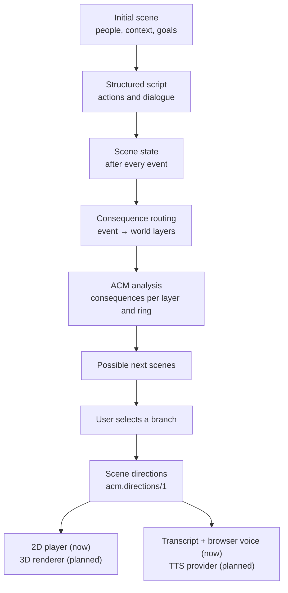

### The world layers: eight layers above every action

ACM's world model is a **stack of layers**, read bottom-up like the OSI network model it
borrows its shape from. An action or event is the source. It happens in the physical world
and is perceived. The **consequence router** then decides which world models, actors and
systems should examine it. Each layer above the router has its own kind of model.

| Level | ACM world layer | Its laws | What it examines | OSI analogy | In ACM today |
|---:|---|---|---|---|---|
| **8** | 🌍 Planetary and ecosystem | Earth laws: ecology, climate, resource cycles, biodiversity | Resources, pollution, biodiversity and sustainability | (beyond the stack) | partly: earth-scoped impact rules; no ecosystem model |
| **7** | 🏛️ Society and collective systems | Economic, legal and social laws | Economy, markets, society, public governance and politics | Application | partly: society/country impact rules; no economic or political model |
| **6** | 🏭 Business and institutions | Institutional laws: contracts, policies, accounting, regulation | Organisations, operations, processes, finance and policies | Presentation | partly: obligations in the scene, organisation impact rules |
| **5** | 💻 Digital and information systems | Digital system laws: data, logic, permissions, protocols | Applications, records, calculations, permissions and workflows | Session | partly: explicit state changes and amounts; no external system connected |
| **4** | 🧠 Human and social | Behavioural and psychological laws (humans and animals) | Goals, behaviour, dialogue, relationships and group reactions | Transport | working: the script model and next scenes (authored or local model) |
| **3** | 🧭 **Consequence routing** | none: routes to the worlds whose laws apply | Which world models, actors and systems should examine an event | Network (routing) | working: `acm.scene.layers.route` |
| **2** | 👁️ Perception and observation | Laws of vibration and signals: light, sound, waves | Images, video, audio, speech, sensors and observations | Data Link | partly: who sees or hears each event; image/video detection is replayed |
| **1** | ⚙️ Physical world | Physical laws; at the atomic scale, atomic and chemical laws | Objects, materials, movement, forces, location and energy | Physical | partly: positions, holders, owners (2D); 3D physics (Unreal) planned; no atomic or chemical model |
| **Source** | 🎬 Action or event | the cause, parsed by MLM into Phrase DNA | Who acts, why, their goal and desired outcome, and what happens | Source | working: the scene script |

The OSI column is an analogy for the stack's shape, not a claim that networking concepts
apply. Inserting the router at level 3 (OSI's routing layer) moves the human and social layer
and everything above it up one level compared with the first draft of this table.

**Layers and rings are two axes.** A layer says *which kind of system* a consequence is about
and which model examines it; a ring (scope) says *how far* it reaches, from the actor to the
world. Every consequence in a scene file has both, e.g. `scope: participants, layer: business`.
Consequences belong to levels 1, 2 and 4 to 8; validation rejects `action` and `routing`.

**The router** (`acm.scene.layers.route`) is a set of explicit rules over each event, and every
route lists the rules that fired:

| Rule | Routed to |
|---|---|
| a physical verb (move, hold, offer, place, take, gesture), a physical object, or a change of position or holder | physical |
| every event: speech is heard and actions are seen by the others present; observations by everyone | perception |
| dialogue, or an action aimed at a person | human and social |
| an object owned by someone other than the actor (the owner becomes involved) | human and social |
| a change to an owned object, or an obligation: records and calculations may apply | digital |
| an obligation (debt, agreement) | business |
| a consequence at a layer cites the event as evidence | that layer |

In the Car Sale, `e2` (Mark offers the Mini) goes to perception (heard by Sarah and Florence),
human and social (dialogue; the car is Sarah's, so she is involved) and digital (an owned
object's status changes). `e7` (the keys stay with Mark) also reaches business, because the
unpaid debt (`c5`) cites it. Society and planetary receive no event and record *not
identified*, which means nothing was identified, not that nothing happens.

The dashboard shows this as section **D · World layers** of `/acm/scenario`: the stack, the
consequences at each layer, the route of every event with its reasons, and a routing table.
The home page shows the generic stack under *What is ACM?*.
### What you can do now

- Open **The Car Sale** in the dashboard (`/acm/scenario`), with no API key, GPU or internet.
  It shows the location, time, people and their goals, the car, the keys, the €5,000 debt,
  and the status: *disputed; handover not completed*.
- Step through the **actions and dialogue** in a 2D scene player, with previous, next and
  replay buttons. The active event, its actor and its target are highlighted. Where the
  browser has speech synthesis, a **Play with voice** button reads the lines aloud.
- Inspect each **actor**: goal, stated position, what they do in the script, possible
  thoughts and feelings (labelled as inferences), consequences that concern them, and
  unknowns. **Focus** on one actor to highlight them everywhere.
- Explore the eight-scope **consequence radius**, as a diagram or as a table.
- Select one of **four next-scene branches** and play it in the same player. Optionally,
  ask the **local model** for more branches.
- **Export** scene 1 or a branch as `acm.directions/1` JSON.
- Do the same from the command line: `acm scene validate | show | analyze | branches |
  select | export | bundle`.

### The demo: Mark, Sarah and Florence

Scene file: [`scenes/car_sale.yaml`](scenes/car_sale.yaml).

**Facts.** Mark and Sarah owe their mutual friend Florence **€5,000**. Sarah owns a red
Austin Mini. Mark offers the car to Florence to settle the debt. Sarah does not agree to
sell it. Two things are unknown: whether Florence knew of Sarah's objection, and whether
Mark has authority to sell. The scene happens in Mark and Sarah's garage in Paris,
*tomorrow at 10:00 a.m.*, which is a label rather than a date. It ends before the handover.
**Nothing in the data says ownership transferred or the debt was settled**, and a test
checks this.

| Actor | Role | Known goal or position |
|---|---|---|
| Mark | Sarah's husband | Wants to settle the €5,000 debt |
| Sarah | Car owner | Does not agree to sell her car |
| Florence | Mutual friend and creditor | Is owed €5,000 |

**Scene 1** (illustrative demo content), seven events:

> Mark stands beside Sarah's red Mini, holding its keys. Florence waits near the garage entrance. Sarah stands beside the car.
> **MARK:** "Florence, we owe you €5,000. I'm offering you the Mini to settle the debt." · *Mark extends the keys toward Florence.*
> **SARAH:** "Stop. That's my car, and I don't agree to sell it." · *Florence pauses.*
> **FLORENCE:** "Mark, did Sarah agree to this?" · *Mark lowers his hand. The keys remain with him.*

The state is computed, not written by hand. After event 3, `keys.offered_to = florence`.
After event 4, `scene.sale = disputed` and `scene.sarah_consent = refused`. At the end, the
keys are still held by Mark, the car's owner is still Sarah, the debt is still unpaid, and
`handover_completed = false`.

**Consequence radius** (eight scopes; the analysis comes from the demo provider):

| Ring | Scope | Consequence | Status |
|---|---|---|---|
| 1 | Mark | His proposed repayment plan is challenged · his relationship with Sarah may be affected | stated · possible |
| 2 | Sarah and Florence | Sarah objects · Florence must decide how to respond · the debt remains unpaid | stated · possible · stated |
| 3 | Immediate physical environment | The car and keys remain in the garage; the keys stay with Mark | stated |
| 4 | Relationships and community | The disagreement could affect the friendship | possible |
| 5 | City and services | Registration may become relevant if a valid sale is eventually agreed | possible |
| 6–8 | Society · economy and country · world | No specific impact established | not identified |

The rings are scopes to investigate, not a chain every effect must pass through.

**Next scenes** (authored, all from the same final state):

| Branch | Assumption | Possible continuation |
|---|---|---|
| A. A repayment plan | Mark accepts Sarah's objection | Keys go on the shelf; the three discuss instalments; Mark picks up a notebook |
| B. Florence steps back | Florence won't take the car without Sarah's agreement | The handover pauses; the debt remains |
| C. The argument escalates | Mark insists on the sale | Sarah keeps objecting; Florence withdraws |
| D. Sarah considers an offer | Sarah is willing to discuss terms | Price and transport come up; Florence defers to Sarah |

Each branch has a written scene with dialogue, its assumptions, how each actor's goal may
be affected, possible feelings (inferences), unknowns, why it is plausible, and its source.
No branch has a probability.

### Facts, authored content, inferences and unknowns

Every item carries its provenance, and the dashboard shows it as a badge:

| Label | Meaning | Example |
|---|---|---|
| `scenario_fact` | given by the scenario | Sarah owns the car |
| `authored_demo` | written for this demo; not a model output | the dialogue, the analysis, branches A–D |
| `generated_inference` | produced by the local model and validated, not verified | branches from **Generate branches** |
| status `stated` | the script says it; must cite the events that say it | Sarah objects (events e2, e4) |
| status `possible` | a plausible inference | Mark may feel pressure |
| status `unknown` | not established | whether Mark may sell the car |
| status `not_identified` | no specific effect found for a scope | society, economy, world |

Thoughts and feelings exist only as `Inference` items. The schema rejects an inference
marked `stated`.

### Architecture and data flow

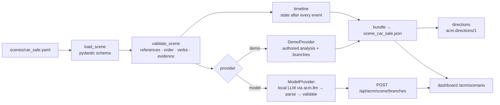

| File | Responsibility |
|---|---|
| [`src/acm/scene/schema.py`](src/acm/scene/schema.py) | the `acm.scene/1` model: Scene, Actor, SceneObject, Event, Change, Consequence, Branch, Inference; Source / Status / Valence / Horizon; the action vocabulary `VERBS` |
| [`src/acm/scene/validate.py`](src/acm/scene/validate.py) | references (actors, objects, marks, events), strictly increasing order, verbs, evidence for stated items, branch checks; `SceneError` lists every problem |
| [`src/acm/scene/state.py`](src/acm/scene/state.py) | initial state from the script, then each event's `effects`; timelines for scene 1 and for branches |
| [`src/acm/scene/providers.py`](src/acm/scene/providers.py) | `DemoProvider`, `ModelProvider`, `generate_branches` (with an honest fallback), parsing and validating model output |
| [`src/acm/scene/directions.py`](src/acm/scene/directions.py) | the `acm.directions/1` export and its validator; flags actions the player cannot show |
| [`src/acm/scene/__init__.py`](src/acm/scene/__init__.py) | `load_scene`, `select_branch`, `bundle` |
| [`src/acm/cli.py`](src/acm/cli.py) | `acm scene ...`; `acm demo --json` also writes `scene_<id>.json` next to the demo results |
| [`scenes/`](scenes/) | scene files, one per scenario |
| [`tests/test_scene.py`](tests/test_scene.py) | 40 tests: validation, state, demo content, branches, export, provider failures |
| MLM repo `src/splm/api/multimodal.py` | `GET /api/acm/scene/status`, `POST /api/acm/scene/branches` |
| MLM repo `web/src/lib/acm/scene.ts` | TypeScript types for the bundle |
| MLM repo `web/src/components/acm/script/` | the demo UI: overview, 2D player and transcript, actor cards, radius, branches, export |

### Running the scene demo

Prerequisites: Python 3.11+, Node 20.9+ for the dashboard, and MLM cloned next to ACM (the
launcher clones it if missing). The scene engine itself needs only `pydantic` and `pyyaml`.

```bash
./start.sh            # sets up .venv, writes the demo data (incl. scene_car_sale.json), starts API + dashboard
# open http://127.0.0.1:3010/acm/scenario      (menu: Prediction Modes → Scene engine: The Car Sale)
#      ...?section=A..F opens a section directly (D: world layers), ...?all=1 shows all sections on one page
./start.sh stop
```

Without the dashboard:

```bash
acm scene validate car_sale        # car_sale: valid (3 actors, 4 objects, 7 events, 4 authored branches)
acm scene show                     # the script as text
acm scene analyze                  # the demo analysis as JSON
acm scene layers                   # the world-layer stack with this scene's consequences per layer
acm scene route                    # where the consequence router sends each event, and why
acm scene select --branch A        # branch A with its timeline and directions
acm scene export --branch A -o a.json
acm scene bundle -o ../SLM/web/public/demo/scene_car_sale.json   # what the dashboard reads
acm scene branches --provider model                              # needs a local model (below)
```

Checks:

```bash
pytest                              # 106 tests (45 for the scene engine); no GPU, no network
cd ../SLM/web && npm run typecheck  # dashboard types
```

### The scene schema and adding a scene

A scene file is YAML validated against `acm.scene/1`. Its top-level keys are:

- `id`, `title`, `description`, `action` (drawn at the centre of the radius)
- `location` (`name`, `city`, `marks`: named spots with optional floor coordinates in metres), `time`
- `context` (scenario facts), `status`, `initial` (scene-level facts), `unknowns`, `caveats`
- `actors`: `id`, `name`, `role`, `relationships`, `goals`, `preferences` (stated positions),
  `constraints`, `position` (a mark), `knows`, `unknown` and `inferences`
- `objects`: `id`, `label`, `kind` (`physical` or `obligation`), `owner`, `holder`,
  `position` and `attributes`
- `events`: `id`, `order`, `actor`, `type` (action, dialogue, observation or state_change),
  `verb`, `target`, `object`, `description`, `dialogue`, `voice`, `animation`, `effects`
  (`subject.attribute = value`) and `source`
- `scopes`: the rings
- `demo`: the authored `conflicts`, `consequences` and `branches` the demo provider returns

Action vocabulary (the player shows all of these; anything else is flagged in an export):
`move`, `hold`, `offer`, `place`, `take`, `speak`, `pause`, `gesture`.

To add a scene, write `scenes/<id>.yaml` and run `acm scene validate <id>`, then
`acm scene bundle <id> -o ../SLM/web/public/demo/scene_<id>.json`. `./start.sh` writes the
bundle for every scene. Open it at `/acm/scenario?scene=<id>`. No UI code changes are
needed: the dashboard renders whatever the bundle contains.

### Demo data vs live generation

- **Prewritten demo branches** (A–D) and the analysis come from `DemoProvider`. They are
  deterministic and offline. They show the interface and the reasoning format; they are not
  predictions.
- **Generated branches** come from `ModelProvider`, which uses the local LLM ACM already
  uses (`acm.llm`: Ollama, `qwen2.5:7b` by default, configured with `ACM_LLM_URL` /
  `ACM_LLM_MODEL`; nothing leaves the machine unless that URL points elsewhere). The reply
  is parsed and **validated against the scene**: unknown people or objects are rejected,
  out-of-vocabulary verbs are dropped, and generated events never change the state. Items
  that fail are reported as rejected.

  When the model is unreachable, times out, or returns malformed or empty output, the
  provider raises an error. The API returns a 503 and the dashboard says why; the
  prewritten branches stay as they are. On the command line,
  `acm scene branches --provider model` falls back to the demo branches and says so on
  stderr; `--no-fallback` makes it fail instead. Generated content is never relabelled,
  and nothing has a probability.
- The model provider generates **branches only**. The scene analysis comes from the
  authored demo content.

### 3D, physics and audio: what exists and what is planned

| Capability | Now | Planned |
|---|---|---|
| Visual | a 2D player in the dashboard, drawn from the state (marks, holders, offers) | a 3D renderer (e.g. Unreal Engine 5) consuming `acm.directions/1`; not integrated |
| Physics | none in the scene engine (the separate physics lab uses matter.js in 2D) | a physics engine for object interactions; not integrated |
| Voice | the browser's built-in speech synthesis reads dialogue lines where available; captions always shown | a TTS provider using the `voice` directions; no generated voices, no lip-sync today |
| Export | `acm.directions/1` JSON, validated (order, references, vocabulary) | adapters that consume it |

### Scene engine limitations and troubleshooting

- There is one scene so far. Its analysis and branches are authored, and the model
  provider adds branches but no analysis.
- The 2D player handles marks, holding, placing and offering. It does not animate paths or
  show gestures beyond an icon.
- Positions are named marks. Coordinates are only used for the 2D layout.
- **"The scene could not be loaded"**: write the bundle (`acm scene bundle ... -o
  ../SLM/web/public/demo/scene_car_sale.json`) or run `./start.sh`.
- **"Generate branches" is disabled**: the API is not running, or no model is pulled
  (`ollama pull qwen2.5:7b`). The reason is shown next to the button.
- **No voice button**: the browser has no speech synthesis. The transcript and captions
  still work.

---

## The blast radius

*The radius is the **how far** axis: rings from the actor out to the world. The rule
engine's code and packs call its outer rings "layers" (neighbour, organization, city,
country, society, earth); in this README those are **rings**, and **layers** means the
[world layers](#the-world-layers-eight-layers-above-every-action), the **which system**
axis.*

### Start with a phrase

> **"I will sell my car to Sarah in Paris tomorrow to pay my debt."**
>
> Context: *"Mark wants to buy my car." "Sarah needs a car."*

ACM reads that one sentence and traces its consequences outwards, ring by ring,
from the people involved out to the whole planet:

| | Ring | What ACM finds for this phrase |
|---|---|---|
| who | **Self** (I) | loses my car · gains money · own goal *pay my debt*: **ENABLED ➕** |
| who | **Impacted** (Sarah) | gains my car · loses money |
| who | **Other actors** | Mark wants to buy my car: **BLOCKED ❌** · Sarah wants a car: **ADVANCED ✅** |
| where | **Local environment** (Paris) | the sale takes place here |
| where | **Neighbours** (Boulogne-Billancourt, Saint-Denis, Montreuil) | no known impact |
| where | **Organization** (Paris city council, Île-de-France regional council, Paris businesses and employers) | insurers and the vehicle registry must record the new owner ● |
| where | **City** (Paris) | no known impact |
| where | **Country** (France) | a taxable transaction counts in national economic activity ● |
| where | **Society** | money circulates through the economy ● |
| where | **Earth** | an existing car is reused instead of a new one being made ▲ |

That whole spread is the action's **blast radius**: the radius of consequences.
Drawn as concentric circles, it runs from the actor to the other participants and
their goals, then to the local physical world, the neighbourhood, the city or region,
society, the economy and countries, and the world:

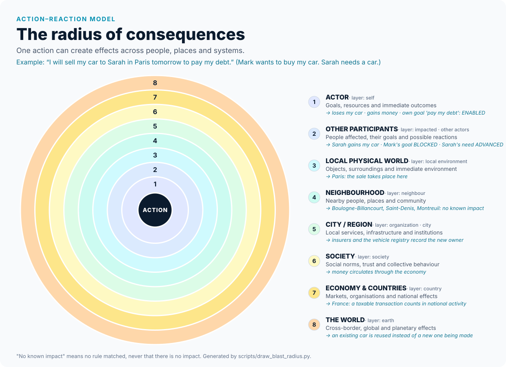

*Generated by [`scripts/draw_blast_radius.py`](scripts/draw_blast_radius.py). The
eight rings group the engine's layers for presentation, and each row names the
layer it shows: other participants = impacted + other actors, city / region =
organization + city, economy & countries = country, the world = earth. The
dashboard's home page has the same diagram, interactive.*

In the engine's own terms, the rings nest, each one containing the one before it:

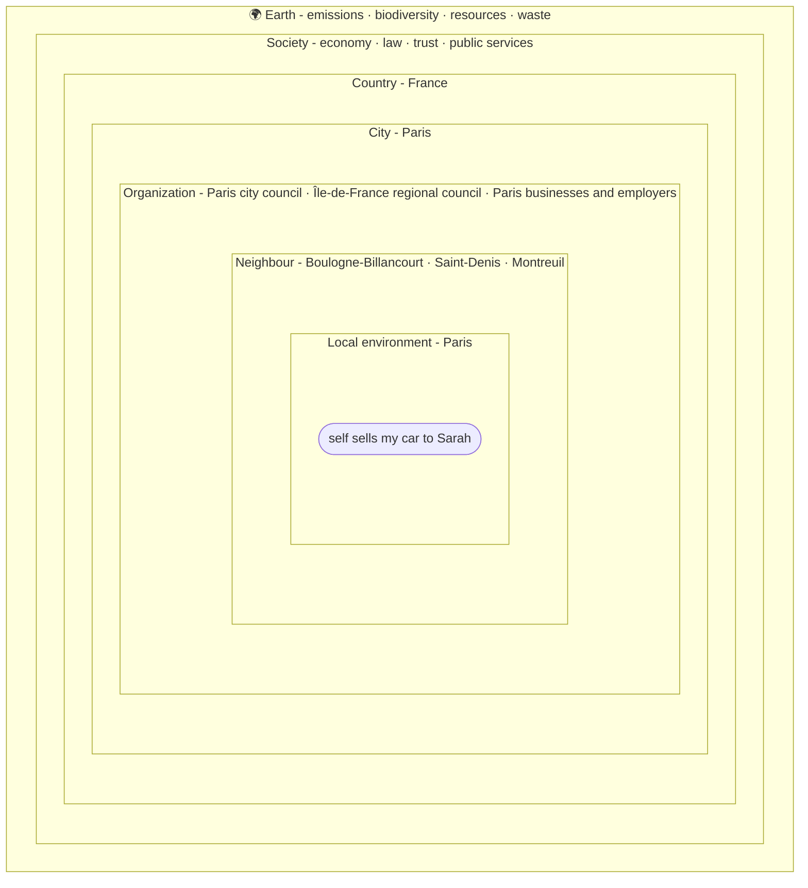

### What each ring means

The blast radius has two parts. Three circles cover **who** is affected. Seven
environment layers cover **where** the effects land, from the place itself
outwards:

**local → neighbours → organization → city → country → society → earth**

| | Circle / layer | Question it answers | Example from other phrases |
|---|---|---|---|
| who | **Self / Actor** | What happens to the one acting? | *John flew to London.* → John is now in London |
| who | **Impacted** | What happens to WHAT / TO WHOM? | *John sold his car to Sarah.* → Sarah gains the car |
| who | **Other actors** | Does it help or block their goals and actions? | *Sarah won the race.* → Mark's goal to win is blocked |
| where | **Local environment** | What changes WHERE it happens? | *The engineer deleted the database in production.* → production no longer has the database |
| where | **Neighbours** | What spills over to the places next to it? | *John flew to London.* → aircraft noise for people near the airports |
| where | **Organization** | Which business, enterprise, institution or system does the place belong to, and what happens to it? | *... deleted the database in production.* → services that rely on the data stop working |
| where | **City** | What changes for the city it is in? | *John traveled to Paris by train.* → uses public transport instead of road space |
| where | **Country** | What changes at national level? | *John flew to London.* → counts in the UK's transport emissions |
| where | **Society** | Economy, law, trust, public services | *John stole the car.* → breaks the law and erodes trust |
| where | **Earth** | Emissions, biodiversity, resources, waste | *The company destroyed the forest.* → biodiversity declines |

Each layer is a module of the same kind:

- Its **extent** says which places the layer covers for this action: Paris's
  neighbours, the organizations it belongs to, its city, its country. This comes
  from the place gazetteer, [`places.yaml`](packs/universal/places.yaml).
- Its **content** says what the action does there. This comes from impact rules
  that name the layer as their `scope`, in
  [`impacts.yaml`](packs/universal/impacts.yaml).

Adding knowledge to a layer is a YAML edit, with no Python changes. "No known
impact" means that no rule matched, never that there is no impact.

The same report as a mind map, in the shape `acm predict --format mermaid` prints
it:

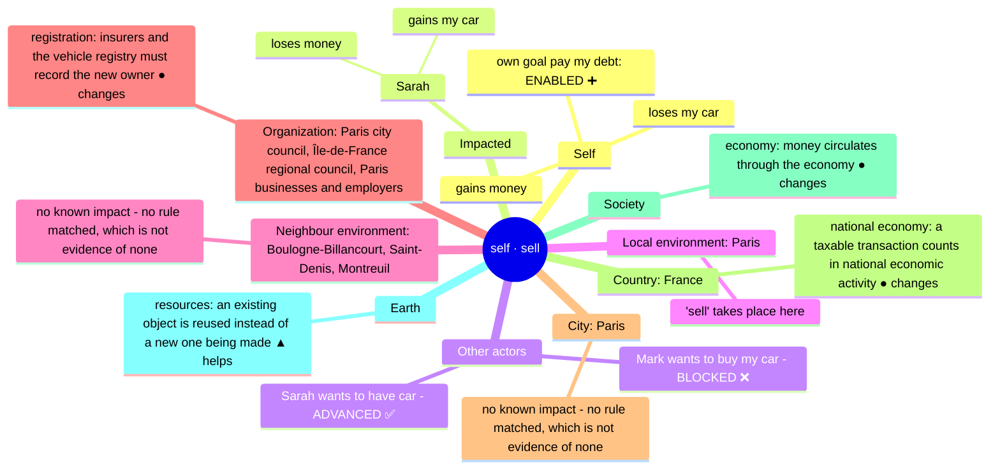

---

## Quick start

ACM needs MLM in the same Python environment. Clone both side by side:

```bash
git clone git@github.com:Sherlock2019/NPLM-Next-Phrase-language-model-.git SLM
git clone git@github.com:Sherlock2019/ACM.git
cd ACM
python -m venv .venv && source .venv/bin/activate
pip install -e ../SLM -e ".[dev]"
pytest                                   # 106 tests, no parser model needed
```

Or let the launcher do it. **`./start.sh` starts the whole POC.** It creates `.venv`
and installs MLM from `../SLM` (or `$SLM_DIR`) and ACM. It then refreshes the demo
results and starts the API and dashboard in the background **as the ACM app**:
`http://127.0.0.1:3010/` opens the **home page**, and on EC2 the launcher also prints
the public-IP address.

**The home page** (`/`, also `/acm/home`) is written for researchers meeting ACM for
the first time. Under the hero ("Every action has consequences"), six chapters
condense this README:

1. **What** ACM is, with the "sell my car to Sarah" blast radius ring by ring.
2. **Why** it exists: the LLM limitations above, with the recorded LLM answers next to
   ACM's.
3. **So what:** the ACM vs LLM-mode table, including where an LLM is still better.
4. **How** it works: the seven steps from Phrase DNA to the LLM wording, plus the
   honesty rules.
5. **The physical world:** the three Unreal Engine 5 systems ACM proposes to use
   ([Step 9](#step-9---the-physical-world-unreal-engine-5)), with the prototype's
   matter.js stand-in stated plainly.
6. **What next:** the research roadmap ([What next](#what-next)).

Four cards then lead into the prediction modes: actions (phrase), object images,
object videos, and objects & human behaviour (concept, not built yet). The header's
**How It Works** menu jumps to chapters 3–6 and to the tour.

**The tour** (`/acm/tour`) explains ACM in four chapters, using real outputs only:

1. **How ACM thinks.** One sentence goes through eight explicit steps: meaning, concept,
   roles, state changes, who they land on, other people's goals, layer rules, certainty.
   Then the answers appear, each with its reason.
2. **ACM vs a language model.** A real local language model (MLM's base model,
   SmolLM2-135M) is asked the same questions; its greedy and sampled answers are
   recorded by `scripts/make_llm_baseline.py`. They sit next to ACM's answer and its why.
   The table only counts what is on screen. The section also says plainly where an LLM
   is better: breadth, fluency, unseen verbs.
3. **One meaning, three senses.** A sentence, a picture and a video of the same scene
   reach the same MLM meaning and the same predicted fall, while keeping their
   different evidence.
4. **Checked against reality.** The video prediction is scored against what happened.

**What happens next?** (`/acm/inference`) lists 53 actions and 283 questions: "what
happens next to Sarah, to Mark's plan, to Paris, to the earth…". Each answer comes
from ACM's recorded trace, with a reasoning chain, a who-is-affected graph and the blast
radius. **▶ Play all** walks through them. The scenarios are in
`examples/inference_suite.yaml`, parsed once by MLM's real parser
(`scripts/make_inference_suite.py`) and frozen in `examples/inference_suite.conllu`.

The ACM demo page shows the tool as intended. It starts with a phrase and its whole
blast radius, as in this README. One **▶ Run Demo** button then runs three inputs, each
predicting the consequences of an action:

1. **A phrase.** Nine action sentences: the sale, a flight, a database deletion, a
   destroyed forest, a theft, a train trip, the Paris sale, a negated sale, and an
   unknown verb. Each is shown ring by ring, from the actor to the earth. Your own
   sentence works in Live mode (MLM parser + ACM).
2. **An image** plus a proposed action. MLM reads the scene; the tabletop simulator and
   ACM predict what the action would do.
3. **A video.** The prediction is made at T = 2 s from earlier frames only. Then the
   video plays on and the prediction is compared with what happened.

The MLM Playground stays at `/mlm`.
`./start.sh cli` opens the interactive prompt, `./start.sh predict "..."` runs any
`acm` command, `./start.sh test` runs the tests and `./start.sh stop` stops it all.

To analyse new text, also install MLM's parser:

```bash
pip install -e "../SLM[parse]"
python ../SLM/scripts/download_resources.py
```

```bash
python -m acm.cli predict "I will sell my car to Sarah in Paris tomorrow to pay my debt." \
    --context "Mark wants to buy my car." --context "Sarah needs a car."
```

```
ACTION  I will sell my car to Sarah in Paris tomorrow to pay my debt.
        concept=SALE  tense=future  certainty=0.90  SELF-VIEW

ACTOR  (self) self
  loses my car
  gains money
  own goal 'pay my debt': ENABLED ➕ - provides what it needs: self has money

IMPACTED
  Sarah: gains my car; loses money

OTHER ACTORS
  Mark wants to buy my car - BLOCKED ❌  (Sarah has my car, so 'Mark has my car' cannot hold)
  Sarah wants to have car - ADVANCED ✅  (makes 'Sarah has car' true)

LOCAL ENVIRONMENT  Paris
  Paris: 'sell' takes place here

NEIGHBOUR ENVIRONMENT  Boulogne-Billancourt, Saint-Denis, Montreuil
  no known impact - no rule matched, which is not evidence of none

ORGANIZATION  Paris city council, Île-de-France regional council, Paris businesses and employers
  registration: insurers and the vehicle registry must record the new owner (● changes)

CITY  Paris
  no known impact - no rule matched, which is not evidence of none

COUNTRY  France
  national economy: a taxable transaction counts in national economic activity (● changes)

SOCIETY
  economy: money circulates through the economy (● changes)

EARTH
  resources: an existing object is reused instead of a new one being made (▲ helps)
```

The last sentence is the action. Earlier sentences, or `--context`, supply the
world it happens in: other actors' goals ("Mark wants to...", "Sarah needs...") and
their actions ("Mark bought a car").

---

## Architecture

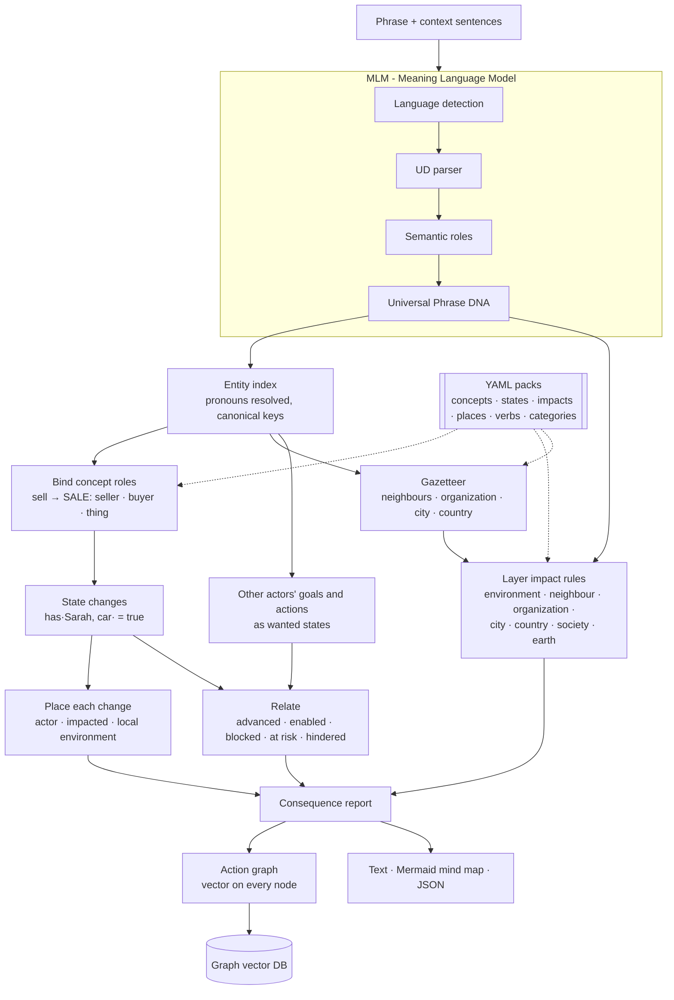

| Stage | Answers | Module | Knowledge |
|---|---|---|---|
| Phrase DNA | Who does what, to whom, where, when, why? | MLM (`splm`) | MLM language packs |
| Entity index | Which mentions are the same entity? | `acm/entities.py` | MLM context graph |
| Binding | Which element plays which part in the action? | `acm/engine.py` | `packs/universal/concepts.yaml`, `packs/<lang>/actions.yaml` |
| State changes | What becomes true or false? | `acm/engine.py` | `packs/universal/states.yaml` |
| Relations | Does that help or block others? | `acm/engine.py` | state exclusivity, concept `requires` |
| Environment layers | What surrounds the place: neighbours, connections, city, country? | `acm/engine.py` | `packs/universal/places.yaml` |
| Impacts | What does it do to each layer, from the site to the earth? | `acm/engine.py` | `packs/universal/impacts.yaml`, `packs/<lang>/categories.yaml` |
| Graph | How does it all connect, as vectors? | `acm/graph.py` | MLM role inventory |
| Store | What have we seen before that looks like this? | `acm/store.py` | SQLite |
| Output | How do we show it? | `acm/render.py`, `acm/cli.py` | - |

As in MLM, **no linguistic or world facts live in Python**. Which verb is a sale,
what a sale changes, which states are exclusive, which country Paris is in and what
flying does to the climate are all YAML under [`packs/`](packs/).

---

## Step 1 - Phrase DNA from MLM

MLM turns each sentence into a language-independent frame. Frames nest: a purpose
or a condition becomes its own frame.

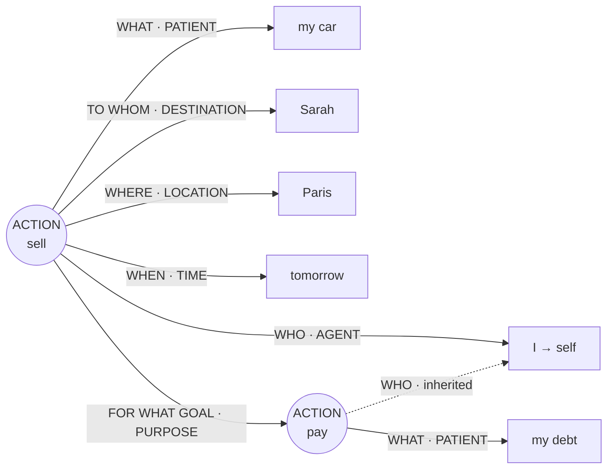

`tense=future  modality=intention  certainty=0.90`. The nested *pay* frame has no
subject of its own, so ACM gives it the outer actor: the debt being paid is the
actor's own.

WHERE (the LOCATION, DESTINATION and SOURCE roles) is the starting point for all
the environment layers. *Paris* becomes the local environment, and the gazetteer
expands it to its neighbours, organization, city and country
([Step 5](#step-5---the-blast-radius-local-to-earth)).

---

## Step 2 - Concepts and state changes

Verbs map onto universal **concepts**, so *sell*, *vendre* and *bán* all reach
`SALE`. A concept says which frame roles fill its parts, what it changes, and what
it requires:

```yaml
SALE:
  roles:
    seller: [AGENT]
    buyer:  [RECIPIENT, BENEFICIARY, DESTINATION@PERSON, DESTINATION@ORG]
    thing:  [PATIENT, THEME, OBJECT]
  effects:
    - { state: has, args: [buyer, thing], primary: true }   # the intended outcome
    - { state: has, args: [seller, thing], value: false }
    - { state: has, args: [seller, =money] }
    - { state: has, args: [buyer, =money], value: false }
  requires:
    - { state: has, args: [seller, thing] }
```

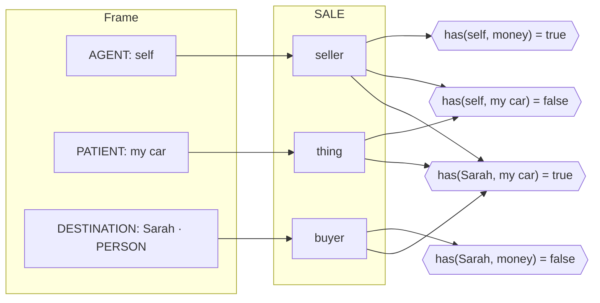

Every consequence is written in a small **state vocabulary**
([`states.yaml`](packs/universal/states.yaml)): `has`, `at`, `exists`, `owes`,
`knows`, `met`, `won`, `damaged`, `helped`. Some states are **exclusive**: a thing
has one owner at a time, an entity is in one place at a time, and a contest has
one winner. Exclusivity is what lets ACM see conflicts between actors.

There are 15 concepts: SALE, PURCHASE, GIFT, THEFT, PAYMENT, MOVE, DEPART, MEET,
DESTROY, CREATE, DEPLOY, INFORM, WIN, DAMAGE and HELP.

---

## Step 3 - Placing each consequence

Each state change is reported under the entity it is about:

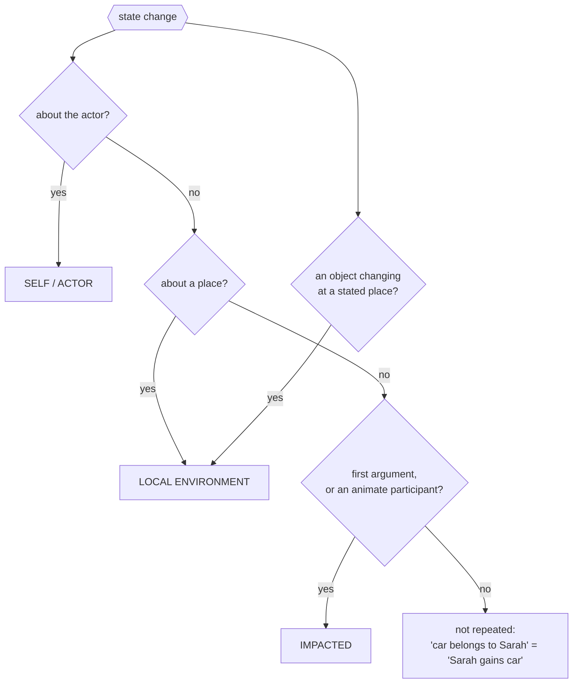

Examples from the tests:

| Action | Actor | Impacted | Local environment |
|---|---|---|---|
| *The engineer deleted the database in production.* | - | database: no longer exists | production: database no longer exists |
| *John flew to London.* | is now in London | - | London: John arrives |
| *John owns a car. He sold it to Sarah.* | loses car, gains money | Sarah: gains car, loses money | - |

State changes stop at the local environment: they are facts about specific
entities and places. Everything further out, from the neighbours to the earth,
comes from layer impact rules, covered in Step 5.

---

## Step 4 - Other actors: goals and actions

Context sentences become **intentions**, written in the same states as the
consequences, which makes them comparable:

| Context | Intention | Wanted / achieved state | Needs |
|---|---|---|---|
| *Mark wants to buy my car.* | goal | `has(Mark, car)` | `has(Mark, money)` |
| *Sarah needs a car.* | goal | `has(Sarah, car)` | - |
| *Mark bought a car.* | action | `has(Mark, car)` | - |
| *... to pay my debt* (in the action itself) | own goal | `owes(self, debt) = false` | `has(self, money)` |

Each intention is then compared with the action's consequences:

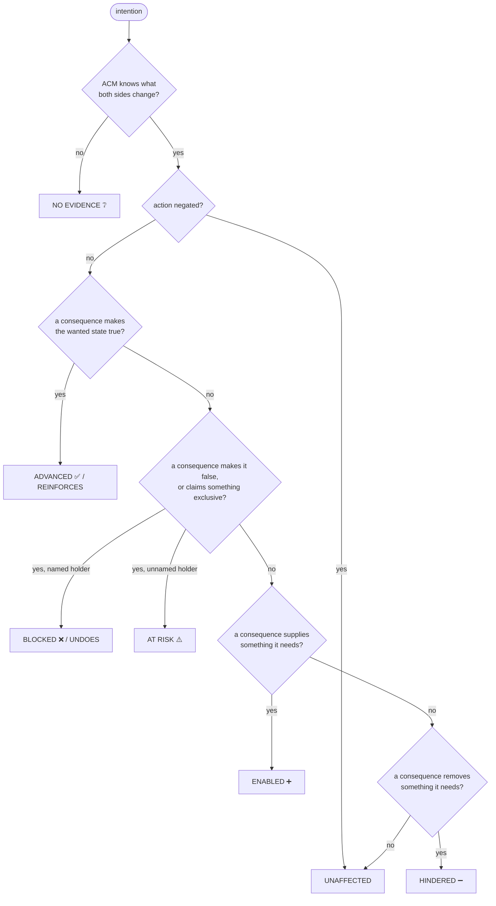

| Context | Action | Relation |
|---|---|---|
| Mark wants to buy John's car. | John will sell his car **to Sarah**. | Mark: **BLOCKED** - Sarah has the car |
| Mark wants to buy John's car. | John sold his car. *(buyer unnamed)* | Mark: **AT RISK** |
| Mark wants to buy John's car. | John **did not** sell his car to Sarah. | Mark: **UNAFFECTED** |
| Sarah needs a car. | John sold his car to Sarah. | Sarah: **ADVANCED** |
| Mark hopes to win the race. | Sarah won the race. | Mark: **BLOCKED** |
| Mark bought a car. | John stole the car. | Mark's action: **UNDOES** |
| *(own purpose)* ... to pay his debt | John will sell his car. | own goal: **ENABLED** - John gains money |
| Mark wants to buy John's car. | John kicked the ball. *(verb unknown)* | Mark: **NO EVIDENCE** |

---

## Step 5 - The blast radius: local to earth

Start with a phrase: **"John flew to London."** Beyond John himself, the flight
reaches people living near the airports (neighbours), the UK's emissions inventory
(country) and the climate (earth). That outward spread is the action's **blast
radius**, and ACM traces it through seven layers:

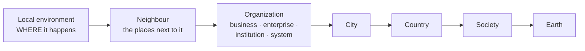

Every layer has the same two parts.

**1. Its extent: what the layer *is* for this action.** ACM looks each place the
action happens at up in the gazetteer,
[`places.yaml`](packs/universal/places.yaml):

```yaml
paris:
  kind: city
  name: Paris
  country: france
  neighbours: [Boulogne-Billancourt, Saint-Denis, Montreuil]
  organization: [Paris city council, Île-de-France regional council, Paris businesses and employers]
production:
  kind: system          # site · business · enterprise · system · city · region · country
  neighbours: [staging and test environments]
  organization: [the enterprise that runs it, its customers and users, services that call it]
```

A city is its own city, and a country is taken from the city when it is not given.
A place that is not in the gazetteer keeps its local environment, but its other
layers are reported as *not known*, with a note. They are never guessed.

| Place | Neighbour | Organization | City | Country |
|---|---|---|---|---|
| Paris | Boulogne-Billancourt, Saint-Denis, Montreuil | Paris city council, Île-de-France regional council, Paris businesses and employers | Paris | France |
| London | Croydon, Watford, Slough | Greater London Authority, City of London financial firms | London | United Kingdom |
| production | staging and test environments | the enterprise that runs it, its customers and users, services that call it | not known | not known |

**2. Its content: what the action does to the layer.** This comes from rules in
[`impacts.yaml`](packs/universal/impacts.yaml), each with a `scope` that names its
layer. A rule fires when the action's concept matches and something involved
belongs to a listed category ([`categories.yaml`](packs/en/categories.yaml)): an
argument, an instrument, a means of transport, or the verb itself.

```yaml
- concepts: [MOVE]
  categories: [aircraft]
  impact: { scope: neighbour, aspect: noise, direction: "-", effect: "aircraft noise and fumes for people living near the airports" }
```

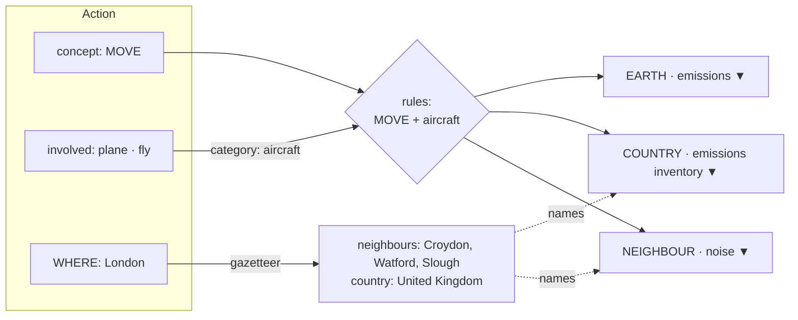

Rules fire whether or not the place is known. A rule states the mechanism, and the
gazetteer names where it lands. *The company destroyed the forest* names no place,
so its neighbour layer still says that nearby communities lose shade and flood
protection, under the heading "no place stated".

| Action | Local | Neighbour | Organization | City | Country | Society | Earth |
|---|---|---|---|---|---|---|---|
| *John flew to London.* | John arrives | noise ▼ | - | - | emissions inventory ▼ | - | emissions ▼ |
| *John traveled to Paris by train.* | John arrives | - | - | traffic ▲ | - | - | emissions ▲ |
| *The company destroyed the forest.* | landscape ▼ | protection ▼ | - | - | natural heritage ▼ | - | biodiversity ▼ |
| *John will sell his car to Sarah in Paris.* | 'sell' takes place | - | registration ● | - | national economy ● | economy ● | resources ▲ |
| *John stole the car.* | - | safety ▼ | insurance ▼ | crime ▼ | national law ▼ | law ▼ | - |
| *The engineer deleted the database in production.* | database no longer exists | - | dependent systems ▼ | - | data protection ▼ | data ▼ | - |
| *John kicked the ball.* | - | - | - | - | - | - | - |

"-" here, and "no known impact" in the output, mean that no rule matched. **It is
never reported as "no impact".** A negated action shows "nothing changes" on every
layer.

---

## Step 6 - The action graph and its vectors

Everything above becomes one graph per action. This is the real graph for John's
version of the scenario (*Mark wants to buy John's car. Sarah needs a car. John
will sell his car to Sarah in Paris tomorrow to pay his debt.*), exactly as
`acm graph` prints it from the test fixtures. The place links to each of its
layers, and each impact sits within its layer:

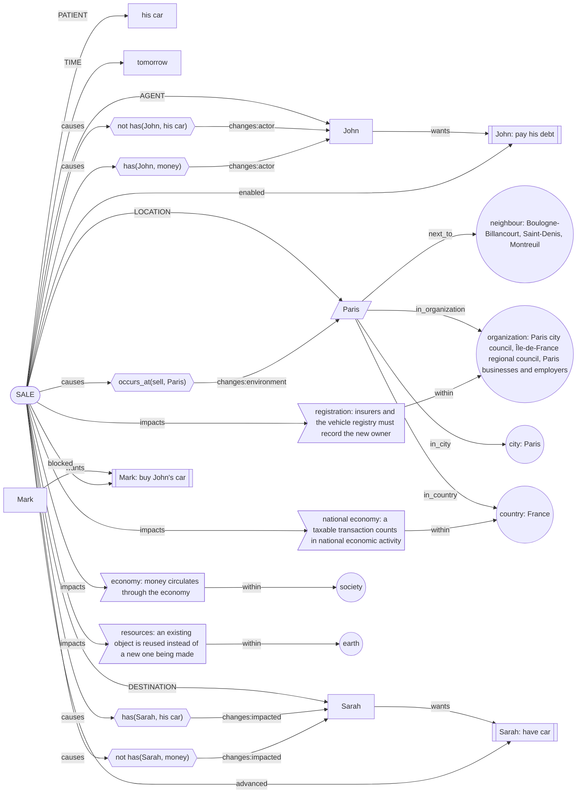

| Shape | Node kind |
|---|---|
| `([ ])` stadium | action |
| `(( ))` circle | self; a layer: neighbour, organization, city, country, society, earth |
| `[ ]` rectangle | entity, time |
| `[/ /]` parallelogram | place |
| `{{ }}` hexagon | state change |
| `> ]` flag | layer impact |
| `[[ ]]` subroutine | another actor's goal or action |

**Every node carries an 83-dimensional vector.** The dimensions are built from MLM's
role and entity-type inventories, so they grow if those do:

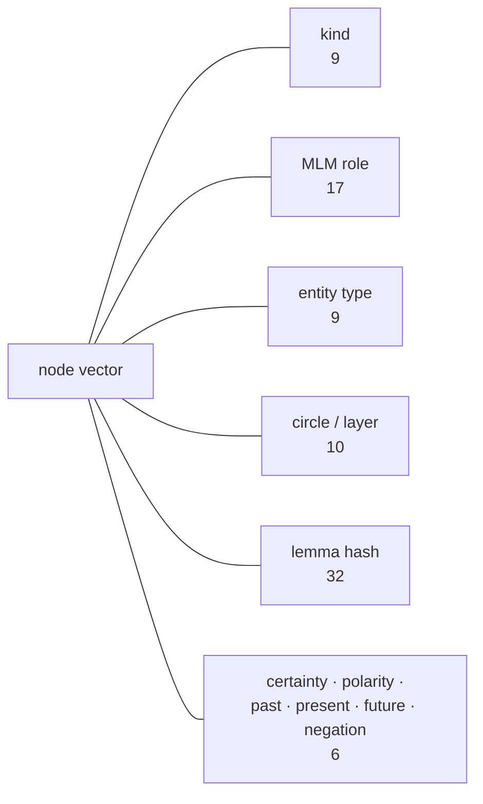

The default `HashingEmbedder` is **structural**. Two nodes are close when they play
the same part in similar actions: *John sold his car to Sarah* and *He sold it to
Sarah* score 1.00. *Car* and *vehicle*, however, are as unrelated as *car* and
*Paris*. A learned embedder can replace it behind the same `embed()` interface.

---

## Step 7 - The graph vector database

`GraphVectorStore` keeps every analysed action in SQLite and searches its vectors
by cosine similarity:

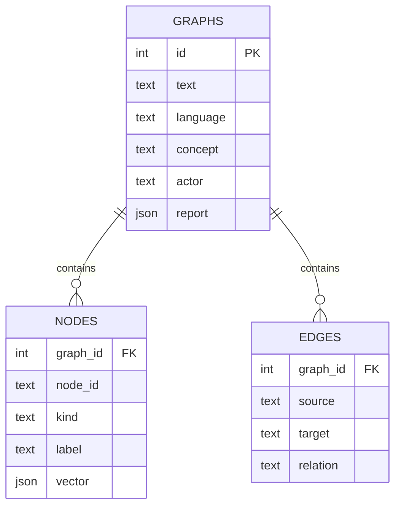

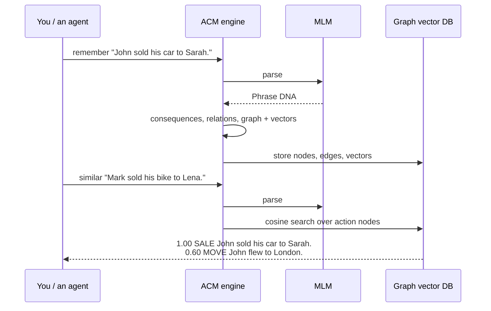

Queries available: `search(vector, kind=...)`, `similar_actions(report)`,
`history(entity)` (everything that ever happened to Sarah) and `stats()`.
Layers are stored like any other part of the graph. `history("paris")` therefore
also returns the place's `next_to`, `in_organization`, `in_city` and `in_country`
links, and `search(vector, kind="impact")` finds past impacts that look alike on
any layer. Search
is exact numpy cosine, which is fine for thousands of nodes. FAISS or pgvector is
the upgrade path behind the same methods.

---

## Step 8 - Multimodal: text, image and video

Start with one scene: *a blue cup near the right edge of a table, a red cup farther
from the edge, and a proposal to push the blue cup toward the edge.* ACM can now
receive that scene from three kinds of evidence, each converted into the **shared MLM
meaning layer** first:

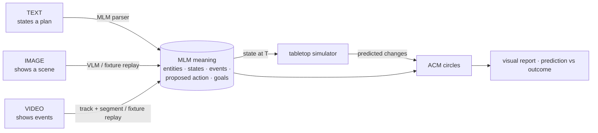

| | Text | Image | Video |
|---|---|---|---|
| What the evidence supports | a stated plan; positions are **assumed** | the scene: cup **near the edge** | events: `pusher_01` **pushes** at 2–3 s, the cup **falls** at 3–4 s |
| What it cannot support | geometry | that anyone pushed it, intends to, or owns it (rejected, with reasons) | why: the fall's cause stays **uncertain** |
| ACM, push toward the edge | moved (rule) · loses the table's support, falls (**simulated**) · damage and spill **unknown** · Society and Earth: **no supporting evidence** | same | same, predicted from frames ≤ 2.0 s only, then compared with the scripted outcome |

The image and video extractions in the demo are hand-authored **replays** matched to
synthetic media. They are labelled as replays everywhere, never as live model output.
The simulator is a constrained rule set, not physics. Full details: schemas,
coordinate frames, leakage rules, uncertainty, backends (Qwen3-VL, YOLO, PyBullet,
V-JEPA 2-AC), evaluation and limitations are in
**[docs/multimodal.md](docs/multimodal.md)** and
[docs/world_model_feasibility.md](docs/world_model_feasibility.md).

```bash
python -m acm.cli demo              # runs all flows, writes docs/demo/tabletop_report.html
```

The interactive version (three tabs with Run buttons, the video checkpoint, and
Demo/Live modes) is the `/multimodal` page of the
[MLM dashboard](https://github.com/Sherlock2019/NPLM-Next-Phrase-language-model-).
With MLM cloned next to ACM (`../SLM`), `./start.sh` starts it. It prints
`http://127.0.0.1:3010/multimodal` and, on EC2, `http://PUBLIC-IP:3010/multimodal`;
open inbound TCP 3010 in the security group and keep 8001 closed.

### Asking questions on the ACM demo page

`/acm` has a chat box under each input:

- **Phrase (live).** MLM parses your question, and ACM answers from its report on the
  action ([`src/acm/ask.py`](src/acm/ask.py), `POST /api/acm/ask`). Each answer row is a
  consequence written in Phrase DNA and chained to the action that causes it:
  *original action → WHO · DOES · WHAT · WHERE · WHEN · WITH WHOM · WHY*, with its ring,
  basis and rule. "What if …?" re-runs ACM on the new clause with the same context and
  lists what is new, what no longer follows and what stays.
- **Image and video (mockup).** The flow starts with recognition: an AI vision model
  recognises each object on screen (plus a tracker for video) and classifies it with a
  **library of objects per environment** (kitchen, house, garden, street, mountain). Each
  library object has its properties: mass, shape, texture and material. The flow then
  adds each class's behaviour profile (friction, fragility, physics rules) → simulate the proposed action with a matter.js
  rigid-body engine, standing in for a game engine such as Unreal → ask about any
  object. The detector is simulated. Object properties are library assumptions, and
  the page labels them that way.
- **The LLM** ([`src/acm/llm.py`](src/acm/llm.py)). A local model, qwen2.5:7b on
  Ollama by default (set `ACM_LLM_URL` / `ACM_LLM_MODEL` to change it), writes each
  answer as plain sentences plus Phrase DNA phrases. It may use **only** the facts ACM or
  the simulator computed. It also reads free-form physics questions into a plan (object,
  intent, action, distance), which the simulator then runs. It never decides a
  consequence, and MLM's meaning step does not use it. When the model is down, the chats
  fall back to ACM's own sentences and the keyword parser.

---

## Step 9 - The physical world: Unreal Engine 5

Words cannot tell an agent whether a pushed mug falls, but a game engine can. To let
an AI see the **physical** consequences of its actions before it takes them, ACM
proposes using three systems that already exist in **Unreal Engine 5**:

| | Unreal Engine 5 system | Role in ACM | What it does |
|---|---|---|---|
| 1 | **Chaos Physics** (+ Chaos Destruction) | simulates the action | rigid bodies, collisions, gravity and breakage. The proposed push becomes a force, the engine steps time, and the mug slides, tips and falls. |
| 2 | **Physical Materials** | gives objects their properties | friction, restitution and density per surface, filled from ACM's per-environment object library (mass, shape, texture, material) |
| 3 | **Sequencer + Movie Render Queue** | shows what would happen | renders the predicted outcome as frames or video from the original camera, so the prediction can be compared frame by frame with what really happened |

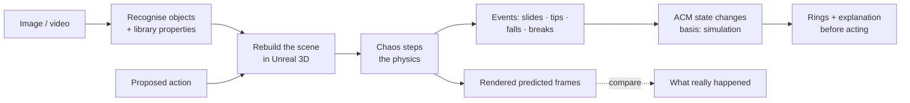

Unreal would sit behind the same `TransitionPredictor` interface
([`src/acm/world/interface.py`](src/acm/world/interface.py)) as the tabletop simulator
and the PyBullet and V-JEPA 2-AC stubs, driven through Unreal's Python / Remote
Control API. The interface's no-future-leakage check applies unchanged. Simulated
events become consequences with the basis `simulation`, so they are never mixed up with
observations.

**Status: proposed, not integrated.** Today the Image / Video chat runs a 2D
**matter.js** rigid-body engine as a stand-in, object detection is mocked, and object
properties are library assumptions. The dashboard labels all three.

---

## Command line

```bash
acm predict  "..." [--context "..."]... [--format text|mermaid|json]
acm graph    "..."                      # the vector graph as a Mermaid flowchart
acm remember "..." [--db data/acm.db]   # store the graph
acm similar  "..." [--db data/acm.db]   # nearest stored actions
acm demo     [--report FILE] [--json FILE]  # multimodal tabletop demo + HTML report
```

(`acm` is installed as a script; `python -m acm.cli` works too.) All three output
formats include every circle and layer. `--format json` puts each layer's
consequences in `consequences` (with `target` set to `environment`, `neighbour`,
`organization`, `city`, `country`, `society` or `earth`) and the layer extents in
`scopes`.

The launcher wraps the same commands:

```bash
./start.sh                              # the whole POC as the ACM app: http://127.0.0.1:3010/ → home page
./start.sh stop | status | restart
./start.sh update                       # git pull ACM + MLM (e.g. on EC2), then restart
./start.sh cli                          # interactive: type an action; '+...' adds a context line
./start.sh predict "..." --format mermaid
./start.sh demo                         # multimodal demo + docs/demo/tabletop_report.html
./start.sh test                         # pytest
./start.sh setup                        # (re)install MLM and ACM into .venv
./dash.sh                               # alias for ./start.sh
```

Python:

```python
from acm import ConsequenceEngine, Target
from acm.render import to_mindmap

engine = ConsequenceEngine()
report = engine.analyze("I will sell my car to Sarah.", context=["Mark wants to buy my car."])
report.for_target(Target.IMPACTED)      # consequences per circle
report.for_target(Target.COUNTRY)       # ... or per layer
report.scopes["city"]                   # what each layer is here: city, country, neighbours, ...
report.other_relations()                # Mark: BLOCKED
print(to_mindmap(report))
```

---

## Honesty rules

These carry over from MLM and are enforced in code and tests:

- **An unknown verb gets no verdict.** If ACM has no concept for a verb, its
  consequences are generic and marked uninformative, and every goal relation is
  *no evidence*, never *unaffected*.
- **No rule is not no impact.** When no rule fires for a layer, from the local
  environment to the earth, the output says so explicitly.
- **An unknown place is not placed.** A place missing from the gazetteer keeps its
  local environment, but its neighbours, connections, city and country are reported
  as *not known*, with a note. They are never guessed.
- **Negation and conditions count.** A negated action changes nothing. A
  conditional one states its condition and has lower certainty (×0.6).
- **Certainty is reported.** Past actions score 1.0 and planned ones 0.8–0.9, or
  whatever MLM's modality analysis gives.
- **An unnamed participant is never assumed.** "John sold his car" puts Mark's goal
  *at risk*, not *blocked*.
- **Vectors are described as what they are:** structural, not semantic.
- **Observed, proposed and predicted never merge.** Every consequence carries its
  basis: `rule`, `simulation` or `observation`. Damage, spills and ownership are
  reported as *unknown* unless a rule or model has what it needs to say more.
- **No future leakage.** A prediction for time T only sees states and events known
  by T. Later video frames are used for evaluation, never as input.

---

## Extending ACM

**A verb:** add `lemma: CONCEPT` to `packs/<lang>/actions.yaml`.

**A concept:** add roles, effects and requires to
`packs/universal/concepts.yaml`. The loader rejects unknown states, wrong
argument counts and unknown roles.

**An impact:** add a rule to `packs/universal/impacts.yaml` with the layer as its
`scope` (`environment`, `neighbour`, `organization`, `city`, `country`, `society`
or `earth`) and, if needed, words to `packs/<lang>/categories.yaml`. The loader
rejects unknown scopes.

**A place:** add an entry to `packs/universal/places.yaml` with its `kind`,
`neighbours`, `organization`, and the `city` and `country` it belongs to.
Those two are keys of other entries, and the loader checks that they are a city
and a country.

**A language:** add `packs/<lang>/actions.yaml` (verbs plus goal markers) and
`categories.yaml`. MLM must support the language.

**A learned embedder:** implement `embed(**features) -> list[float]` with a `dim`
attribute and pass it as `ConsequenceEngine(embedder=...)`.

---

## Limitations

- **Seed knowledge.** There are 18 concepts, about 50 English verbs (fewer in French
  and Vietnamese), about 40 impact rules and about 20 gazetteer places. Anything
  outside them falls back to generic consequences or to "not known".
- **Layers come from a gazetteer, not a map.** The neighbours and connections of a
  place are a hand-written list, and a common-noun place such as *production* or
  *factory* has no city or country of its own.
- **Entity identity is coarse for text.** Common nouns are keyed by head lemma, so
  "John's car" and "his car" match, but two different cars would also match. Frames
  from images and video carry explicit ids (`cup_01`, `cup_02`), which always win.
- **The tabletop simulator is narrow.** It handles rigid discs on one rectangular
  table: no friction, force, tipping or bouncing. The multimodal demo replays
  hand-authored extractions; no vision model has been run (see
  [docs/multimodal.md](docs/multimodal.md)).
- **Layer impacts are rules, not models.** From the neighbour layer to the earth
  they show the mechanism, not a measured footprint.
- **MLM's parse errors propagate.** For example, French *à Sarah* is read as a
  location.
- **Explanations are rendered in English only;** the reasoning is
  language-independent.
- **No learned components yet.** Consequences, relations and embeddings are
  rule-based or structural. They are the baseline a trained version must beat.
- **No 3D physics yet.** The physics lab is a 2D matter.js stand-in for Unreal Engine 5
  ([Step 9](#step-9---the-physical-world-unreal-engine-5)).

---

## Tests and scripts

```bash
pytest                              # 106 tests: CoNLL-U, multimodal and scene fixtures, no GPU, no network
python -m acm.cli demo              # multimodal demo, self-contained HTML report
python scripts/make_fixtures.py     # regenerate fixtures (needs MLM's parser); review the diff
python scripts/draw_vision.py       # regenerate docs/acm-vision.svg from a real run
```

## Project layout

```
ACM/
  start.sh           launcher: starts the whole POC (API + dashboard); also cli, any acm command, tests
  dash.sh            alias for start.sh
  scenes/            scene-engine scripts (acm.scene/1): car_sale.yaml
  src/acm/scene/     scene engine: schema, validate, state, layers (world layers + router),
                     providers, directions, bundle
  packs/universal/   states, concepts, impacts (per layer), places (gazetteer),
                     simulation (predicted change → state), settings
  packs/<lang>/      actions (verb → concept, goal markers), categories
  src/acm/           engine, entities, graph (vectors), store, render, cli
                     multimodal (MLM meaning → ACM), demo, evaluation, visual_report,
                     inference (Q&A suite), ask (questions about an action, in Phrase DNA)
  src/acm/world/     transition interface, tabletop simulator, PyBullet / V-JEPA stubs
  scripts/           make_fixtures.py, draw_vision.py, make_inference_suite.py, make_llm_baseline.py
  examples/          inference_suite.yaml (+ frozen .conllu), llm_baseline.json (recorded LLM answers)
  tests/             106 tests over committed fixtures
  docs/              multimodal.md, world_model_feasibility.md, demo/tabletop_report.html,
                     acm-vision.svg / .png
```

## Licence

Copyright © 2026 Dzoan Nguyen Tran (dzoanNguyentran@gmail.com). Released under the
[MIT licence](LICENSE). MLM is a separate project under its own MIT licence.
