# Actions Consequential Model (ACM)

**See what an action changes before taking it.**

> A language model predicts the next word. MLM first works out what a sentence means.
> **ACM goes one step further: it predicts what an action *does*. It traces the
> consequences for the one acting, for those it lands on, for other actors' goals,
> and then across its whole blast radius, layer by layer: the place it happens,
> its neighbours, the organization it belongs to, its city, its country, society,
> and the earth.**

ACM is built on the [Meaning Language Model (MLM)](https://github.com/Sherlock2019/NPLM-Next-Phrase-language-model-),
which turns a phrase into *Universal Phrase DNA*: who does what, to whom, where,
when, how and why. ACM turns that structure into a graph of the full action in its
context. It predicts the consequences circle by circle (who is affected) and
across the **blast radius**, layer by layer (where the effects reach, from the site
of the action out to the earth). It stores every node as a vector so it can be
compared with past actions. When the actor is **"I"**, the report is the model's
view of its **own** planned action.

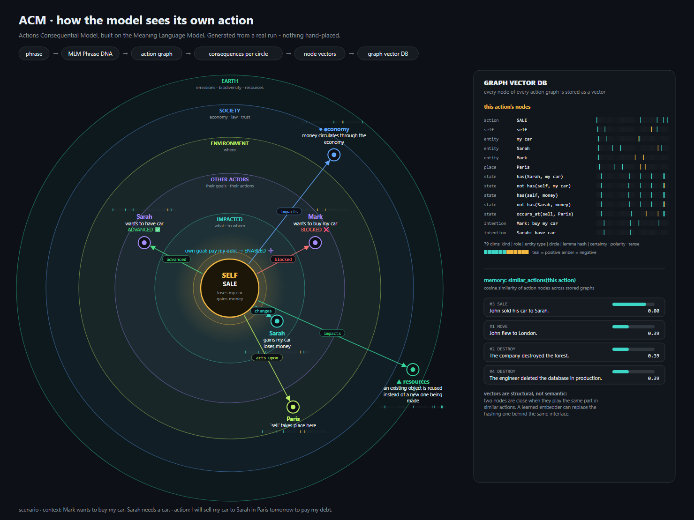

*Generated by [`scripts/draw_vision.py`](scripts/draw_vision.py) from a real run:
the MLM parser plus the ACM engine. Nothing is placed by hand. Each ring shows what
ACM's report put there. The coloured strips are the actual node vectors, and the
scores on the right come from a real search of the graph vector store.*
*The image predates the blast-radius layers (neighbour, organization, city and
country) and still shows the original six circles. Regenerating it needs MLM's
parser. The [blast radius diagram](#the-blast-radius) below shows every layer.*

---

## Contents

- [The blast radius](#the-blast-radius)
- [Quick start](#quick-start)
- [Architecture](#architecture)
- [Step 1 - Phrase DNA from MLM](#step-1---phrase-dna-from-mlm)
- [Step 2 - Concepts and state changes](#step-2---concepts-and-state-changes)
- [Step 3 - Placing each consequence](#step-3---placing-each-consequence)
- [Step 4 - Other actors: goals and actions](#step-4---other-actors-goals-and-actions)
- [Step 5 - The blast radius: local to earth](#step-5---the-blast-radius-local-to-earth)
- [Step 6 - The action graph and its vectors](#step-6---the-action-graph-and-its-vectors)
- [Step 7 - The graph vector database](#step-7---the-graph-vector-database)
- [Step 8 - Multimodal: text, image and video](#step-8---multimodal-text-image-and-video)
- [Command line](#command-line)
- [Honesty rules](#honesty-rules)
- [Extending ACM](#extending-acm)
- [Limitations](#limitations)
- [Project layout](#project-layout)

---

## The blast radius

### Start with a phrase

> **"I will sell my car to Sarah in Paris tomorrow to pay my debt."**
>
> Context: *"Mark wants to buy my car." "Sarah needs a car."*

ACM reads that one sentence and traces its consequences outwards, ring by ring,
from the people involved out to the whole planet:

| | Ring | What ACM finds for this phrase |
|---|---|---|
| who | **Self** (I) | loses my car · gains money · own goal *pay my debt*: **ENABLED ➕** |
| who | **Impacted** (Sarah) | gains my car · loses money |
| who | **Other actors** | Mark wants to buy my car: **BLOCKED ❌** · Sarah wants a car: **ADVANCED ✅** |
| where | **Local environment** (Paris) | the sale takes place here |
| where | **Neighbours** (Boulogne-Billancourt, Saint-Denis, Montreuil) | no known impact |
| where | **Organization** (Paris city council, Île-de-France regional council, Paris businesses and employers) | insurers and the vehicle registry must record the new owner ● |
| where | **City** (Paris) | no known impact |
| where | **Country** (France) | a taxable transaction counts in national economic activity ● |
| where | **Society** | money circulates through the economy ● |
| where | **Earth** | an existing car is reused instead of a new one being made ▲ |

That whole spread is the action's **blast radius**. The rings nest, each one
containing the one before it:

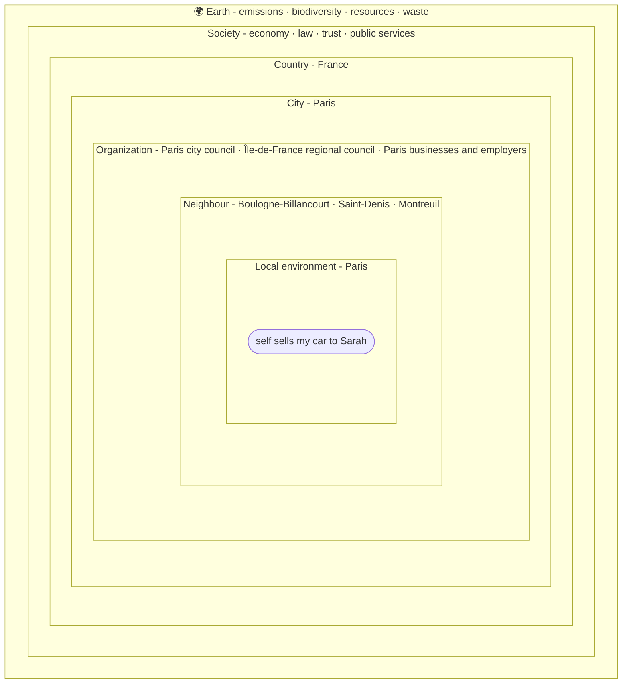

### What each ring means

The blast radius has two parts. Three circles cover **who** is affected. Seven
environment layers cover **where** the effects land, from the place itself
outwards:

**local → neighbours → organization → city → country → society → earth**

| | Circle / layer | Question it answers | Example from other phrases |
|---|---|---|---|
| who | **Self / Actor** | What happens to the one acting? | *John flew to London.* → John is now in London |
| who | **Impacted** | What happens to WHAT / TO WHOM? | *John sold his car to Sarah.* → Sarah gains the car |
| who | **Other actors** | Does it help or block their goals and actions? | *Sarah won the race.* → Mark's goal to win is blocked |
| where | **Local environment** | What changes WHERE it happens? | *The engineer deleted the database in production.* → production no longer has the database |
| where | **Neighbours** | What spills over to the places next to it? | *John flew to London.* → aircraft noise for people near the airports |
| where | **Organization** | Which business, enterprise, institution or system does the place belong to, and what happens to it? | *... deleted the database in production.* → services that rely on the data stop working |
| where | **City** | What changes for the city it is in? | *John traveled to Paris by train.* → uses public transport instead of road space |
| where | **Country** | What changes at national level? | *John flew to London.* → counts in the UK's transport emissions |
| where | **Society** | Economy, law, trust, public services | *John stole the car.* → breaks the law and erodes trust |
| where | **Earth** | Emissions, biodiversity, resources, waste | *The company destroyed the forest.* → biodiversity declines |

Each layer is a module of the same kind:

- Its **extent** says which places the layer covers for this action: Paris's
  neighbours, the organizations it belongs to, its city, its country. This comes
  from the place gazetteer, [`places.yaml`](packs/universal/places.yaml).
- Its **content** says what the action does there. This comes from impact rules
  that name the layer as their `scope`, in
  [`impacts.yaml`](packs/universal/impacts.yaml).

Adding knowledge to a layer is a YAML edit, with no Python changes. "No known
impact" means that no rule matched, never that there is no impact.

The same report as a mind map, in the shape `acm predict --format mermaid` prints
it:

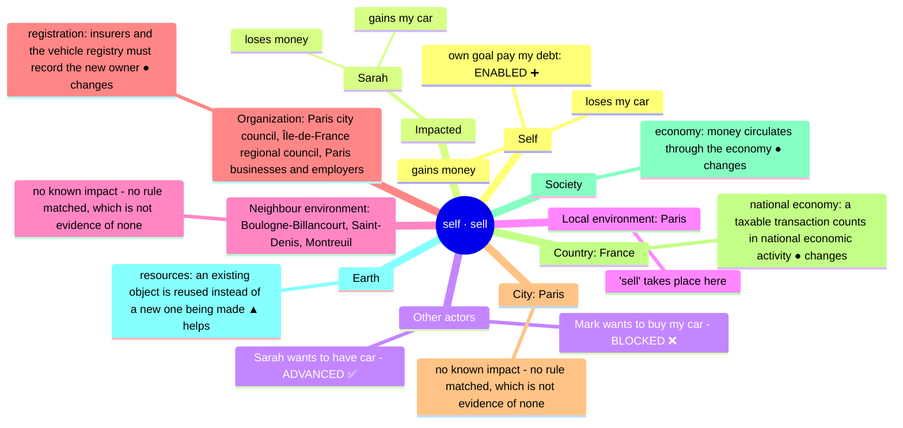

---

## Quick start

ACM needs MLM in the same Python environment. Clone both side by side:

```bash
git clone git@github.com:Sherlock2019/NPLM-Next-Phrase-language-model-.git SLM
git clone git@github.com:Sherlock2019/ACM.git
cd ACM
python -m venv .venv && source .venv/bin/activate
pip install -e ../SLM -e ".[dev]"
pytest                                   # 61 tests, no parser model needed
```

Or let the launcher do it. **`./start.sh` starts the whole POC.** It creates `.venv`
and installs MLM from `../SLM` (or `$SLM_DIR`) and ACM. It then refreshes the demo
results and starts the API and dashboard in the background **as the ACM app**:
`http://127.0.0.1:3010/` opens the **tour**, and on EC2 the launcher also prints the
public-IP address.

**The tour** (the home page, `/`) explains ACM in four chapters, using real outputs
only:

1. **How ACM thinks.** One sentence goes through eight explicit steps: meaning, concept,
   roles, state changes, who they land on, other people's goals, layer rules, certainty.
   Then the answers appear, each with its reason.
2. **ACM vs a language model.** A real local language model (MLM's base model,
   SmolLM2-135M) is asked the same questions; its greedy and sampled answers are
   recorded by `scripts/make_llm_baseline.py`. They sit next to ACM's answer and its why.
   The table only counts what is on screen. The section also says plainly where an LLM
   is better: breadth, fluency, unseen verbs.
3. **One meaning, three senses.** A sentence, a picture and a video of the same scene
   reach the same MLM meaning and the same predicted fall, while keeping their
   different evidence.
4. **Checked against reality.** The video prediction is scored against what happened.

**What happens next?** (`/acm/inference`) lists 53 actions and 283 questions: "what
happens next to Sarah, to Mark's plan, to Paris, to the earth…". Each answer comes
from ACM's recorded trace, with a reasoning chain, a who-is-affected graph and the blast
radius. **▶ Play all** walks through them. The scenarios are in
`examples/inference_suite.yaml`, parsed once by MLM's real parser
(`scripts/make_inference_suite.py`) and frozen in `examples/inference_suite.conllu`.

The ACM demo page shows the tool as intended. It starts with a phrase and its whole
blast radius, as in this README. One **▶ Run Demo** button then runs three inputs, each
predicting the consequences of an action:

1. **A phrase.** Nine action sentences: the sale, a flight, a database deletion, a
   destroyed forest, a theft, a train trip, the Paris sale, a negated sale, and an
   unknown verb. Each is shown ring by ring, from the actor to the earth. Your own
   sentence works in Live mode (MLM parser + ACM).
2. **An image** plus a proposed action. MLM reads the scene; the tabletop simulator and
   ACM predict what the action would do.
3. **A video.** The prediction is made at T = 2 s from earlier frames only. Then the
   video plays on and the prediction is compared with what happened.

The MLM Playground stays at `/mlm`.
`./start.sh cli` opens the interactive prompt, `./start.sh predict "..."` runs any
`acm` command, `./start.sh test` runs the tests and `./start.sh stop` stops it all.

To analyse new text, also install MLM's parser:

```bash
pip install -e "../SLM[parse]"
python ../SLM/scripts/download_resources.py
```

```bash
python -m acm.cli predict "I will sell my car to Sarah in Paris tomorrow to pay my debt." \
    --context "Mark wants to buy my car." --context "Sarah needs a car."
```

```
ACTION  I will sell my car to Sarah in Paris tomorrow to pay my debt.
        concept=SALE  tense=future  certainty=0.90  SELF-VIEW

ACTOR  (self) self
  loses my car
  gains money
  own goal 'pay my debt': ENABLED ➕ - provides what it needs: self has money

IMPACTED
  Sarah: gains my car; loses money

OTHER ACTORS
  Mark wants to buy my car - BLOCKED ❌  (Sarah has my car, so 'Mark has my car' cannot hold)
  Sarah wants to have car - ADVANCED ✅  (makes 'Sarah has car' true)

LOCAL ENVIRONMENT  Paris
  Paris: 'sell' takes place here

NEIGHBOUR ENVIRONMENT  Boulogne-Billancourt, Saint-Denis, Montreuil
  no known impact - no rule matched, which is not evidence of none

ORGANIZATION  Paris city council, Île-de-France regional council, Paris businesses and employers
  registration: insurers and the vehicle registry must record the new owner (● changes)

CITY  Paris
  no known impact - no rule matched, which is not evidence of none

COUNTRY  France
  national economy: a taxable transaction counts in national economic activity (● changes)

SOCIETY
  economy: money circulates through the economy (● changes)

EARTH
  resources: an existing object is reused instead of a new one being made (▲ helps)
```

The last sentence is the action. Earlier sentences, or `--context`, supply the
world it happens in: other actors' goals ("Mark wants to...", "Sarah needs...") and
their actions ("Mark bought a car").

---

## Architecture

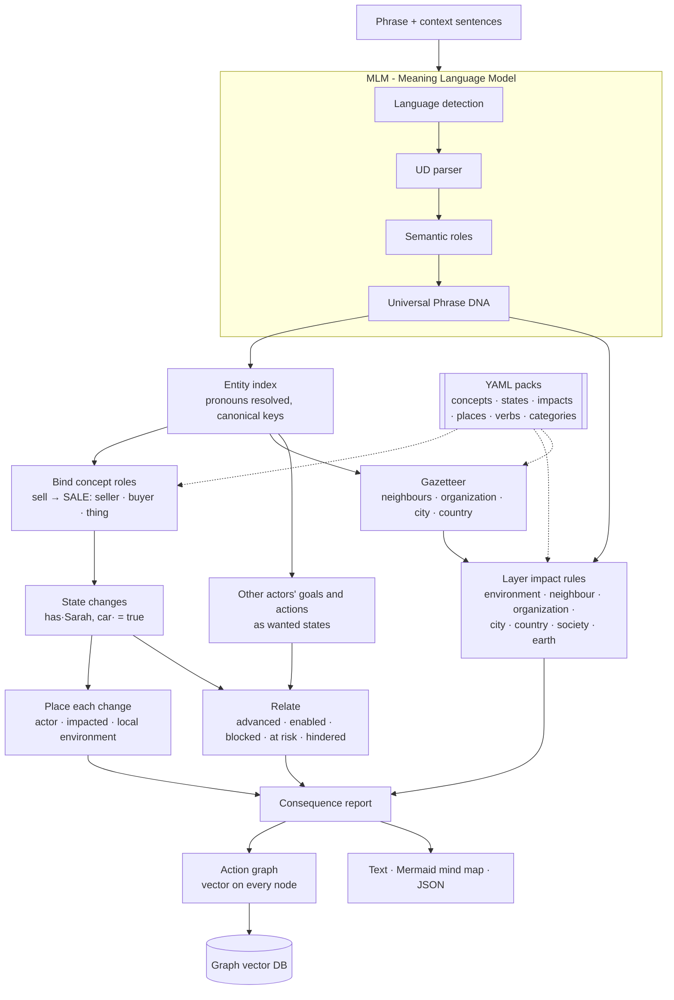

| Stage | Answers | Module | Knowledge |
|---|---|---|---|
| Phrase DNA | Who does what, to whom, where, when, why? | MLM (`splm`) | MLM language packs |
| Entity index | Which mentions are the same entity? | `acm/entities.py` | MLM context graph |
| Binding | Which element plays which part in the action? | `acm/engine.py` | `packs/universal/concepts.yaml`, `packs/<lang>/actions.yaml` |
| State changes | What becomes true or false? | `acm/engine.py` | `packs/universal/states.yaml` |
| Relations | Does that help or block others? | `acm/engine.py` | state exclusivity, concept `requires` |
| Environment layers | What surrounds the place: neighbours, connections, city, country? | `acm/engine.py` | `packs/universal/places.yaml` |
| Impacts | What does it do to each layer, from the site to the earth? | `acm/engine.py` | `packs/universal/impacts.yaml`, `packs/<lang>/categories.yaml` |
| Graph | How does it all connect, as vectors? | `acm/graph.py` | MLM role inventory |
| Store | What have we seen before that looks like this? | `acm/store.py` | SQLite |
| Output | How do we show it? | `acm/render.py`, `acm/cli.py` | - |

As in MLM, **no linguistic or world facts live in Python**. Which verb is a sale,
what a sale changes, which states are exclusive, which country Paris is in and what
flying does to the climate are all YAML under [`packs/`](packs/).

---

## Step 1 - Phrase DNA from MLM

MLM turns each sentence into a language-independent frame. Frames nest: a purpose
or a condition becomes its own frame.

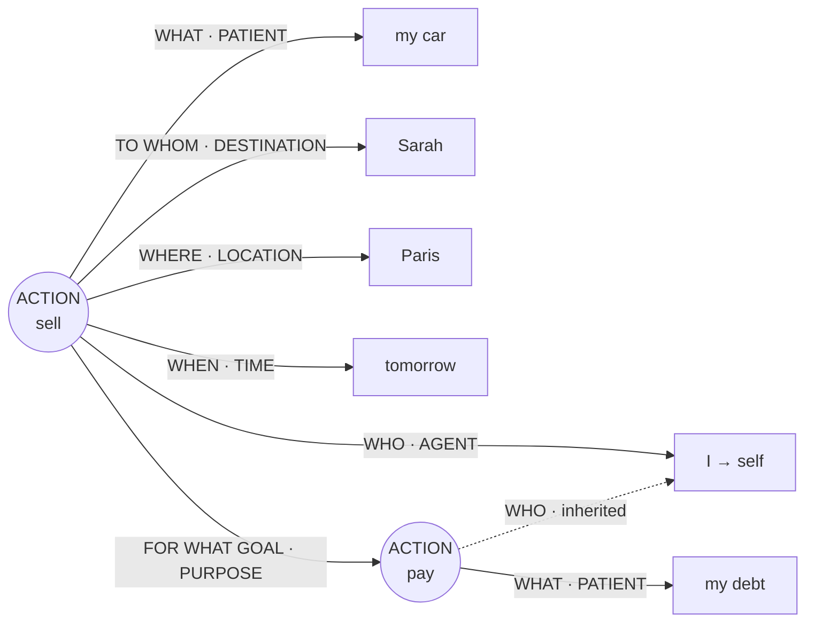

`tense=future  modality=intention  certainty=0.90`. The nested *pay* frame has no
subject of its own, so ACM gives it the outer actor: the debt being paid is the
actor's own.

WHERE (the LOCATION, DESTINATION and SOURCE roles) is the starting point for all
the environment layers. *Paris* becomes the local environment, and the gazetteer
expands it to its neighbours, organization, city and country
([Step 5](#step-5---the-blast-radius-local-to-earth)).

---

## Step 2 - Concepts and state changes

Verbs map onto universal **concepts**, so *sell*, *vendre* and *bán* all reach
`SALE`. A concept says which frame roles fill its parts, what it changes, and what
it requires:

```yaml
SALE:
  roles:
    seller: [AGENT]
    buyer:  [RECIPIENT, BENEFICIARY, DESTINATION@PERSON, DESTINATION@ORG]
    thing:  [PATIENT, THEME, OBJECT]
  effects:
    - { state: has, args: [buyer, thing], primary: true }   # the intended outcome
    - { state: has, args: [seller, thing], value: false }
    - { state: has, args: [seller, =money] }
    - { state: has, args: [buyer, =money], value: false }
  requires:
    - { state: has, args: [seller, thing] }
```

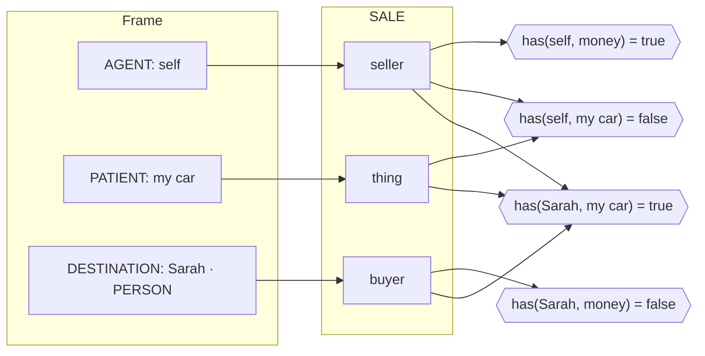

Every consequence is written in a small **state vocabulary**
([`states.yaml`](packs/universal/states.yaml)): `has`, `at`, `exists`, `owes`,
`knows`, `met`, `won`, `damaged`, `helped`. Some states are **exclusive**: a thing
has one owner at a time, an entity is in one place at a time, and a contest has
one winner. Exclusivity is what lets ACM see conflicts between actors.

There are 15 concepts: SALE, PURCHASE, GIFT, THEFT, PAYMENT, MOVE, DEPART, MEET,
DESTROY, CREATE, DEPLOY, INFORM, WIN, DAMAGE and HELP.

---

## Step 3 - Placing each consequence

Each state change is reported under the entity it is about:

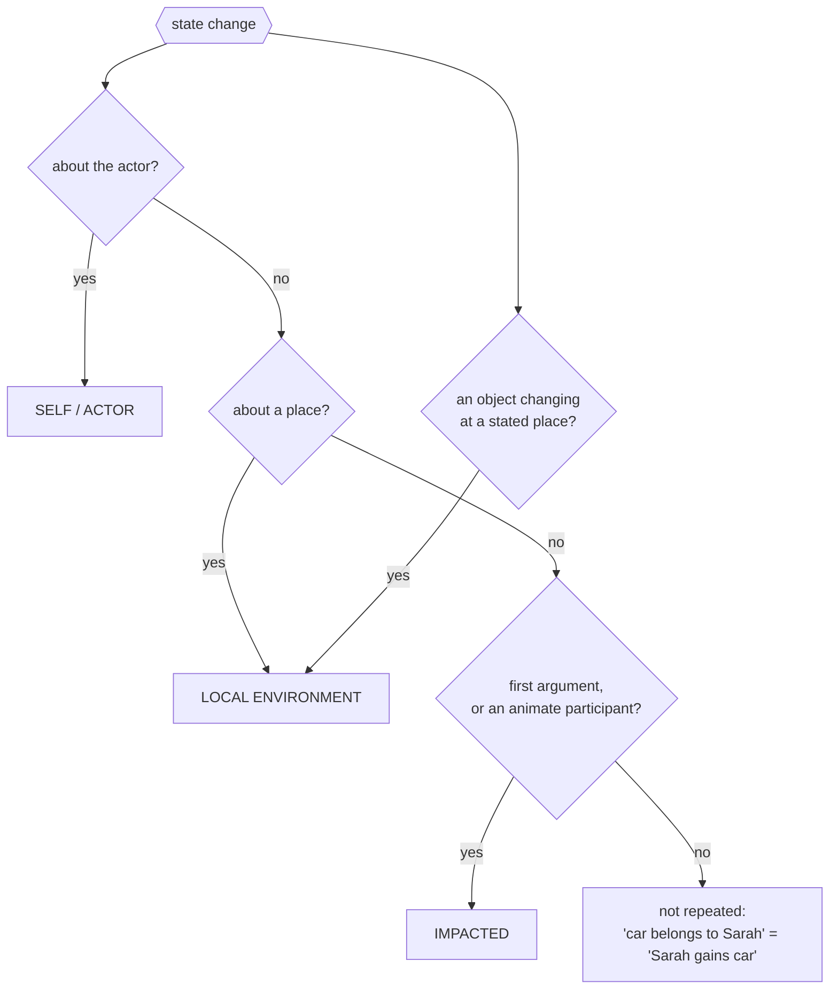

Examples from the tests:

| Action | Actor | Impacted | Local environment |
|---|---|---|---|
| *The engineer deleted the database in production.* | - | database: no longer exists | production: database no longer exists |
| *John flew to London.* | is now in London | - | London: John arrives |
| *John owns a car. He sold it to Sarah.* | loses car, gains money | Sarah: gains car, loses money | - |

State changes stop at the local environment: they are facts about specific
entities and places. Everything further out, from the neighbours to the earth,
comes from layer impact rules, covered in Step 5.

---

## Step 4 - Other actors: goals and actions

Context sentences become **intentions**, written in the same states as the
consequences, which makes them comparable:

| Context | Intention | Wanted / achieved state | Needs |
|---|---|---|---|
| *Mark wants to buy my car.* | goal | `has(Mark, car)` | `has(Mark, money)` |
| *Sarah needs a car.* | goal | `has(Sarah, car)` | - |
| *Mark bought a car.* | action | `has(Mark, car)` | - |
| *... to pay my debt* (in the action itself) | own goal | `owes(self, debt) = false` | `has(self, money)` |

Each intention is then compared with the action's consequences:

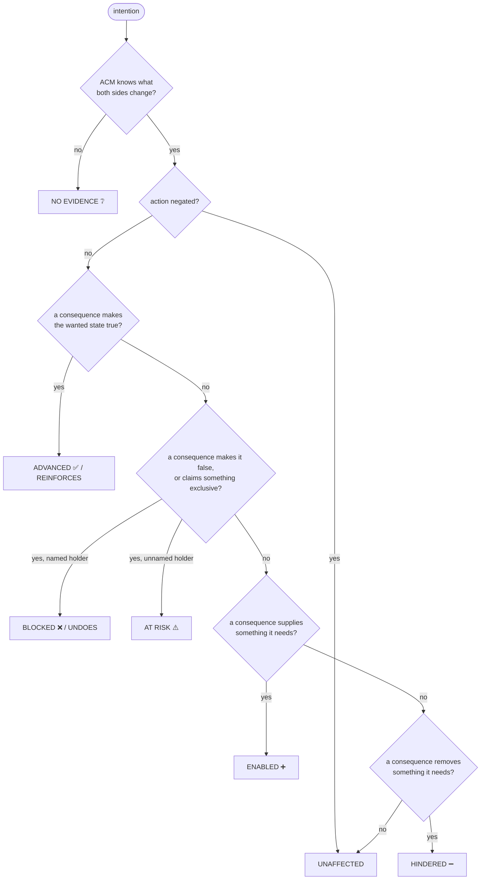

| Context | Action | Relation |
|---|---|---|
| Mark wants to buy John's car. | John will sell his car **to Sarah**. | Mark: **BLOCKED** - Sarah has the car |
| Mark wants to buy John's car. | John sold his car. *(buyer unnamed)* | Mark: **AT RISK** |
| Mark wants to buy John's car. | John **did not** sell his car to Sarah. | Mark: **UNAFFECTED** |
| Sarah needs a car. | John sold his car to Sarah. | Sarah: **ADVANCED** |
| Mark hopes to win the race. | Sarah won the race. | Mark: **BLOCKED** |
| Mark bought a car. | John stole the car. | Mark's action: **UNDOES** |
| *(own purpose)* ... to pay his debt | John will sell his car. | own goal: **ENABLED** - John gains money |
| Mark wants to buy John's car. | John kicked the ball. *(verb unknown)* | Mark: **NO EVIDENCE** |

---

## Step 5 - The blast radius: local to earth

Start with a phrase: **"John flew to London."** Beyond John himself, the flight
reaches people living near the airports (neighbours), the UK's emissions inventory
(country) and the climate (earth). That outward spread is the action's **blast
radius**, and ACM traces it through seven layers:

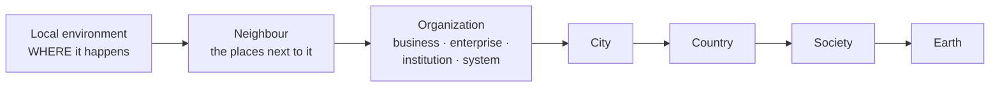

Every layer has the same two parts.

**1. Its extent: what the layer *is* for this action.** ACM looks each place the
action happens at up in the gazetteer,
[`places.yaml`](packs/universal/places.yaml):

```yaml
paris:
  kind: city
  name: Paris
  country: france
  neighbours: [Boulogne-Billancourt, Saint-Denis, Montreuil]
  organization: [Paris city council, Île-de-France regional council, Paris businesses and employers]
production:
  kind: system          # site · business · enterprise · system · city · region · country
  neighbours: [staging and test environments]
  organization: [the enterprise that runs it, its customers and users, services that call it]
```

A city is its own city, and a country is taken from the city when it is not given.
A place that is not in the gazetteer keeps its local environment, but its other
layers are reported as *not known*, with a note. They are never guessed.

| Place | Neighbour | Organization | City | Country |
|---|---|---|---|---|
| Paris | Boulogne-Billancourt, Saint-Denis, Montreuil | Paris city council, Île-de-France regional council, Paris businesses and employers | Paris | France |
| London | Croydon, Watford, Slough | Greater London Authority, City of London financial firms | London | United Kingdom |
| production | staging and test environments | the enterprise that runs it, its customers and users, services that call it | not known | not known |

**2. Its content: what the action does to the layer.** This comes from rules in
[`impacts.yaml`](packs/universal/impacts.yaml), each with a `scope` that names its
layer. A rule fires when the action's concept matches and something involved
belongs to a listed category ([`categories.yaml`](packs/en/categories.yaml)): an
argument, an instrument, a means of transport, or the verb itself.

```yaml
- concepts: [MOVE]
  categories: [aircraft]
  impact: { scope: neighbour, aspect: noise, direction: "-", effect: "aircraft noise and fumes for people living near the airports" }
```

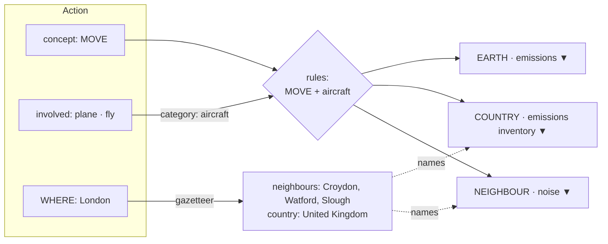

Rules fire whether or not the place is known. A rule states the mechanism, and the
gazetteer names where it lands. *The company destroyed the forest* names no place,
so its neighbour layer still says that nearby communities lose shade and flood
protection, under the heading "no place stated".

| Action | Local | Neighbour | Organization | City | Country | Society | Earth |
|---|---|---|---|---|---|---|---|
| *John flew to London.* | John arrives | noise ▼ | - | - | emissions inventory ▼ | - | emissions ▼ |
| *John traveled to Paris by train.* | John arrives | - | - | traffic ▲ | - | - | emissions ▲ |
| *The company destroyed the forest.* | landscape ▼ | protection ▼ | - | - | natural heritage ▼ | - | biodiversity ▼ |
| *John will sell his car to Sarah in Paris.* | 'sell' takes place | - | registration ● | - | national economy ● | economy ● | resources ▲ |
| *John stole the car.* | - | safety ▼ | insurance ▼ | crime ▼ | national law ▼ | law ▼ | - |
| *The engineer deleted the database in production.* | database no longer exists | - | dependent systems ▼ | - | data protection ▼ | data ▼ | - |
| *John kicked the ball.* | - | - | - | - | - | - | - |

"-" here, and "no known impact" in the output, mean that no rule matched. **It is
never reported as "no impact".** A negated action shows "nothing changes" on every
layer.

---

## Step 6 - The action graph and its vectors

Everything above becomes one graph per action. This is the real graph for John's
version of the scenario (*Mark wants to buy John's car. Sarah needs a car. John
will sell his car to Sarah in Paris tomorrow to pay his debt.*), exactly as
`acm graph` prints it from the test fixtures. The place links to each of its
layers, and each impact sits within its layer:

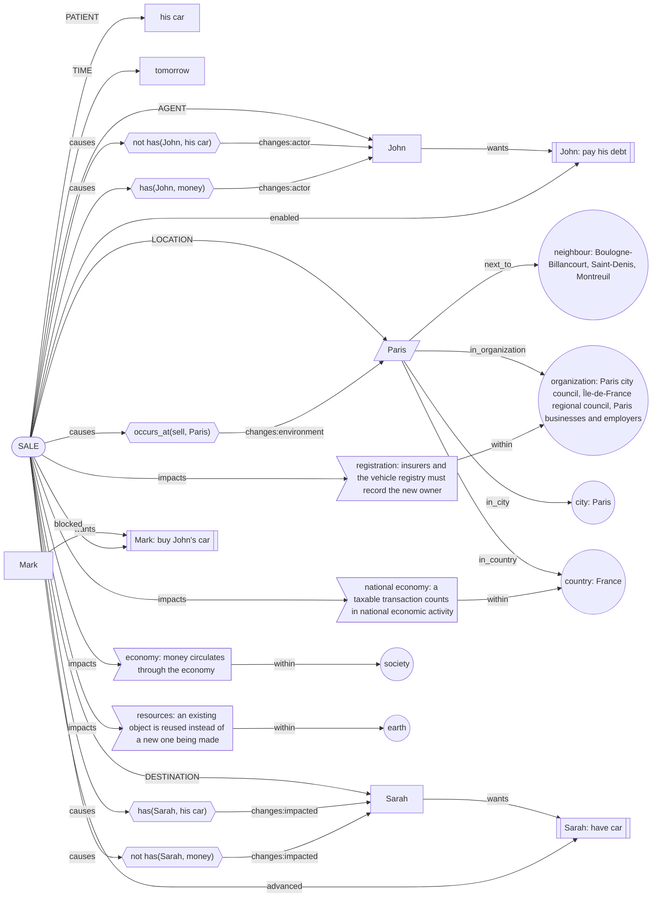

| Shape | Node kind |
|---|---|
| `([ ])` stadium | action |
| `(( ))` circle | self; a layer: neighbour, organization, city, country, society, earth |
| `[ ]` rectangle | entity, time |
| `[/ /]` parallelogram | place |
| `{{ }}` hexagon | state change |
| `> ]` flag | layer impact |
| `[[ ]]` subroutine | another actor's goal or action |

**Every node carries an 83-dimensional vector.** The dimensions are built from MLM's
role and entity-type inventories, so they grow if those do:

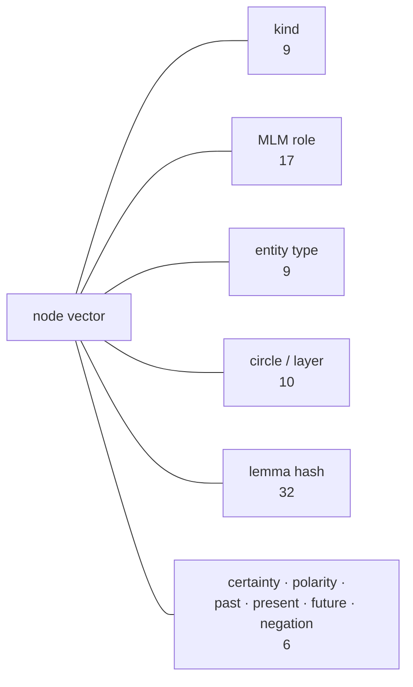

The default `HashingEmbedder` is **structural**. Two nodes are close when they play
the same part in similar actions: *John sold his car to Sarah* and *He sold it to
Sarah* score 1.00. *Car* and *vehicle*, however, are as unrelated as *car* and
*Paris*. A learned embedder can replace it behind the same `embed()` interface.

---

## Step 7 - The graph vector database

`GraphVectorStore` keeps every analysed action in SQLite and searches its vectors
by cosine similarity:

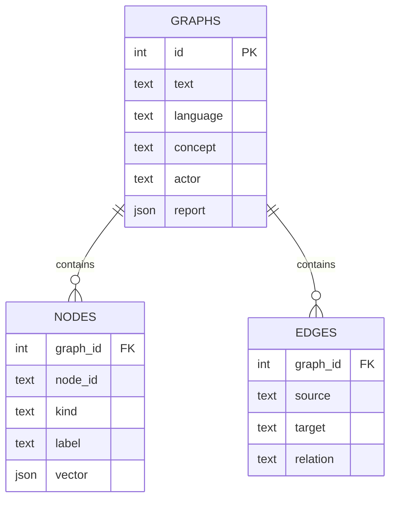

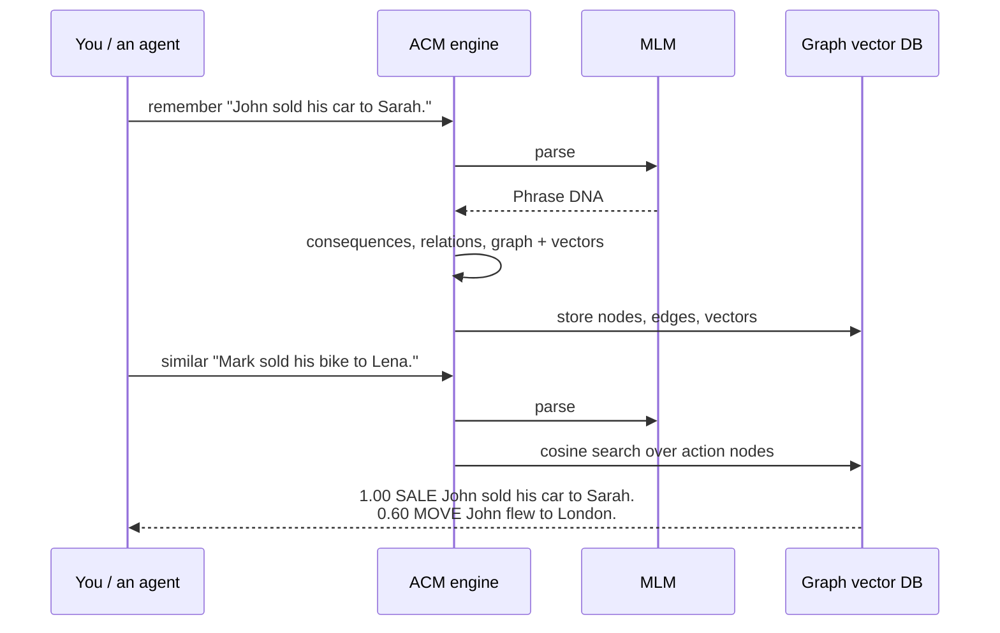

Queries available: `search(vector, kind=...)`, `similar_actions(report)`,
`history(entity)` (everything that ever happened to Sarah) and `stats()`.
Layers are stored like any other part of the graph. `history("paris")` therefore
also returns the place's `next_to`, `in_organization`, `in_city` and `in_country`
links, and `search(vector, kind="impact")` finds past impacts that look alike on
any layer. Search
is exact numpy cosine, which is fine for thousands of nodes. FAISS or pgvector is
the upgrade path behind the same methods.

---

## Step 8 - Multimodal: text, image and video

Start with one scene: *a blue cup near the right edge of a table, a red cup farther
from the edge, and a proposal to push the blue cup toward the edge.* ACM can now
receive that scene from three kinds of evidence, each converted into the **shared MLM
meaning layer** first:

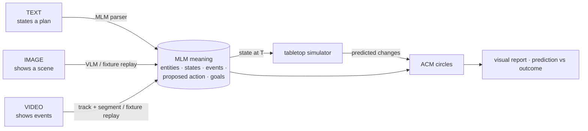

| | Text | Image | Video |
|---|---|---|---|
| What the evidence supports | a stated plan; positions are **assumed** | the scene: cup **near the edge** | events: `pusher_01` **pushes** at 2–3 s, the cup **falls** at 3–4 s |
| What it cannot support | geometry | that anyone pushed it, intends to, or owns it (rejected, with reasons) | why: the fall's cause stays **uncertain** |
| ACM, push toward the edge | moved (rule) · loses the table's support, falls (**simulated**) · damage and spill **unknown** · Society and Earth: **no supporting evidence** | same | same, predicted from frames ≤ 2.0 s only, then compared with the scripted outcome |

The image and video extractions in the demo are hand-authored **replays** matched to
synthetic media. They are labelled as replays everywhere, never as live model output.
The simulator is a constrained rule set, not physics. Full details: schemas,
coordinate frames, leakage rules, uncertainty, backends (Qwen3-VL, YOLO, PyBullet,
V-JEPA 2-AC), evaluation and limitations are in
**[docs/multimodal.md](docs/multimodal.md)** and
[docs/world_model_feasibility.md](docs/world_model_feasibility.md).

```bash
python -m acm.cli demo              # runs all flows, writes docs/demo/tabletop_report.html
```

The interactive version (three tabs with Run buttons, the video checkpoint, and
Demo/Live modes) is the `/multimodal` page of the
[MLM dashboard](https://github.com/Sherlock2019/NPLM-Next-Phrase-language-model-).
With MLM cloned next to ACM (`../SLM`), `./start.sh` starts it. It prints
`http://127.0.0.1:3010/multimodal` and, on EC2, `http://PUBLIC-IP:3010/multimodal`;
open inbound TCP 3010 in the security group and keep 8001 closed.

---

## Command line

```bash
acm predict  "..." [--context "..."]... [--format text|mermaid|json]
acm graph    "..."                      # the vector graph as a Mermaid flowchart
acm remember "..." [--db data/acm.db]   # store the graph
acm similar  "..." [--db data/acm.db]   # nearest stored actions
acm demo     [--report FILE] [--json FILE]  # multimodal tabletop demo + HTML report
```

(`acm` is installed as a script; `python -m acm.cli` works too.) All three output
formats include every circle and layer. `--format json` puts each layer's
consequences in `consequences` (with `target` set to `environment`, `neighbour`,
`organization`, `city`, `country`, `society` or `earth`) and the layer extents in
`scopes`.

The launcher wraps the same commands:

```bash
./start.sh                              # the whole POC as the ACM app: http://127.0.0.1:3010/ → tour
./start.sh stop | status | restart
./start.sh cli                          # interactive: type an action; '+...' adds a context line
./start.sh predict "..." --format mermaid
./start.sh demo                         # multimodal demo + docs/demo/tabletop_report.html
./start.sh test                         # pytest
./start.sh setup                        # (re)install MLM and ACM into .venv
./dash.sh                               # alias for ./start.sh
```

Python:

```python
from acm import ConsequenceEngine, Target
from acm.render import to_mindmap

engine = ConsequenceEngine()
report = engine.analyze("I will sell my car to Sarah.", context=["Mark wants to buy my car."])
report.for_target(Target.IMPACTED)      # consequences per circle
report.for_target(Target.COUNTRY)       # ... or per layer
report.scopes["city"]                   # what each layer is here: city, country, neighbours, ...
report.other_relations()                # Mark: BLOCKED
print(to_mindmap(report))
```

---

## Honesty rules

These carry over from MLM and are enforced in code and tests:

- **An unknown verb gets no verdict.** If ACM has no concept for a verb, its
  consequences are generic and marked uninformative, and every goal relation is
  *no evidence*, never *unaffected*.
- **No rule is not no impact.** When no rule fires for a layer, from the local
  environment to the earth, the output says so explicitly.
- **An unknown place is not placed.** A place missing from the gazetteer keeps its
  local environment, but its neighbours, connections, city and country are reported
  as *not known*, with a note. They are never guessed.
- **Negation and conditions count.** A negated action changes nothing. A
  conditional one states its condition and has lower certainty (×0.6).
- **Certainty is reported.** Past actions score 1.0 and planned ones 0.8–0.9, or
  whatever MLM's modality analysis gives.
- **An unnamed participant is never assumed.** "John sold his car" puts Mark's goal
  *at risk*, not *blocked*.
- **Vectors are described as what they are:** structural, not semantic.
- **Observed, proposed and predicted never merge.** Every consequence carries its
  basis: `rule`, `simulation` or `observation`. Damage, spills and ownership are
  reported as *unknown* unless a rule or model has what it needs to say more.
- **No future leakage.** A prediction for time T only sees states and events known
  by T. Later video frames are used for evaluation, never as input.

---

## Extending ACM

**A verb:** add `lemma: CONCEPT` to `packs/<lang>/actions.yaml`.

**A concept:** add roles, effects and requires to
`packs/universal/concepts.yaml`. The loader rejects unknown states, wrong
argument counts and unknown roles.

**An impact:** add a rule to `packs/universal/impacts.yaml` with the layer as its
`scope` (`environment`, `neighbour`, `organization`, `city`, `country`, `society`
or `earth`) and, if needed, words to `packs/<lang>/categories.yaml`. The loader
rejects unknown scopes.

**A place:** add an entry to `packs/universal/places.yaml` with its `kind`,
`neighbours`, `organization`, and the `city` and `country` it belongs to.
Those two are keys of other entries, and the loader checks that they are a city
and a country.

**A language:** add `packs/<lang>/actions.yaml` (verbs plus goal markers) and
`categories.yaml`. MLM must support the language.

**A learned embedder:** implement `embed(**features) -> list[float]` with a `dim`
attribute and pass it as `ConsequenceEngine(embedder=...)`.

---

## Limitations

- **Seed knowledge.** There are 18 concepts, about 50 English verbs (fewer in French
  and Vietnamese), about 40 impact rules and about 20 gazetteer places. Anything
  outside them falls back to generic consequences or to "not known".
- **Layers come from a gazetteer, not a map.** The neighbours and connections of a
  place are a hand-written list, and a common-noun place such as *production* or
  *factory* has no city or country of its own.
- **Entity identity is coarse for text.** Common nouns are keyed by head lemma, so
  "John's car" and "his car" match, but two different cars would also match. Frames
  from images and video carry explicit ids (`cup_01`, `cup_02`), which always win.
- **The tabletop simulator is narrow.** It handles rigid discs on one rectangular
  table: no friction, force, tipping or bouncing. The multimodal demo replays
  hand-authored extractions; no vision model has been run (see
  [docs/multimodal.md](docs/multimodal.md)).
- **Layer impacts are rules, not models.** From the neighbour layer to the earth
  they show the mechanism, not a measured footprint.
- **MLM's parse errors propagate.** For example, French *à Sarah* is read as a
  location.
- **Explanations are rendered in English only;** the reasoning is
  language-independent.
- **No learned components yet.** Consequences, relations and embeddings are
  rule-based or structural. They are the baseline a trained version must beat.

---

## Tests and scripts

```bash
pytest                              # 61 tests: CoNLL-U fixtures + multimodal fixtures, no GPU, no network
python -m acm.cli demo              # multimodal demo, self-contained HTML report
python scripts/make_fixtures.py     # regenerate fixtures (needs MLM's parser); review the diff
python scripts/draw_vision.py       # regenerate docs/acm-vision.svg from a real run
```

## Project layout

```
ACM/
  start.sh           launcher: starts the whole POC (API + dashboard); also cli, any acm command, tests
  dash.sh            alias for start.sh
  packs/universal/   states, concepts, impacts (per layer), places (gazetteer),
                     simulation (predicted change → state), settings
  packs/<lang>/      actions (verb → concept, goal markers), categories
  src/acm/           engine, entities, graph (vectors), store, render, cli
                     multimodal (MLM meaning → ACM), demo, evaluation, visual_report
  src/acm/world/     transition interface, tabletop simulator, PyBullet / V-JEPA stubs
  scripts/           make_fixtures.py, draw_vision.py, make_inference_suite.py, make_llm_baseline.py
  examples/          inference_suite.yaml (+ frozen .conllu), llm_baseline.json (recorded LLM answers)
  tests/             61 tests over committed fixtures
  docs/              multimodal.md, world_model_feasibility.md, demo/tabletop_report.html,
                     acm-vision.svg / .png
```

## Licence

MIT. MLM is a separate project under its own MIT licence.
