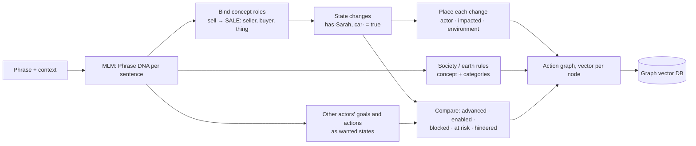

# Consequence Action Model (CAM)

**See what an action changes before taking it.**

CAM is built on the [Meaning Language Model (MLM)](https://github.com/Sherlock2019/NPLM-Next-Phrase-language-model-),
a separate repository. MLM turns a
phrase into Universal Phrase DNA: who does what, to whom, where, when and why. CAM
turns that frame into a graph of the full action in its context. It then predicts
what the action changes in each circle around the actor:

| Circle | Question | Example |
|---|---|---|
| **Self / Actor** | What happens to the one acting? | loses the car, gains money |
| **Impacted** | What happens to WHAT / TO WHOM? | Sarah gains the car |
| **Other actors** | Does it help or block their goals and actions? | Mark's goal "buy the car" is blocked |
| **Environment** | What changes WHERE it happens? | the database no longer exists in production |
| **Society** | Economy, law, trust, public services | money circulates through the economy |
| **Earth** | Emissions, biodiversity, resources, waste | flying emits CO2 |

When the actor is "I", the report is the model's view of its own planned action.


*Generated by `scripts/draw_vision.py` from a real run. Each circle shows
what CAM's report put there. The strips are the actual node vectors, and the
similarity scores come from a real search of the graph vector store.*

---

## Quick start

CAM needs MLM installed in the same environment. Clone both repositories side by
side:

```bash
git clone git@github.com:Sherlock2019/NPLM-Next-Phrase-language-model-.git SLM
git clone <this repository> CAM
cd CAM
python -m venv .venv && source .venv/bin/activate
pip install -e ../SLM -e ".[dev]"
pytest                                   # no parser model needed
```

Parsing new text also needs MLM's parser. Install it with `pip install -e
"../SLM[parse]"`, then run `python ../SLM/scripts/download_resources.py`. After that:

```bash
python -m cam.cli predict "I will sell my car to Sarah in Paris tomorrow to pay my debt." \
    --context "Mark wants to buy my car." --context "Sarah needs a car."
```

```
ACTION  I will sell my car to Sarah in Paris tomorrow to pay my debt.
        concept=SALE  tense=future  certainty=0.90  SELF-VIEW

ACTOR  (self) self
  loses my car
  gains money
  own goal 'pay my debt': ENABLED ➕ - provides what it needs: self has money

IMPACTED
  Sarah: gains my car; loses money

OTHER ACTORS
  Mark wants to buy my car - BLOCKED ❌  (Sarah has my car, so 'Mark has my car' cannot hold)
  Sarah wants to have car - ADVANCED ✅  (makes 'Sarah has car' true)

ENVIRONMENT  Paris
  Paris: 'sell' takes place here

SOCIETY
  economy: money circulates through the economy (● changes)

EARTH
  resources: an existing object is reused instead of a new one being made (▲ helps)
```

Other outputs:

```bash
python -m cam.cli predict "..." --format mermaid   # mind map of the six circles
python -m cam.cli predict "..." --format json      # the full report
python -m cam.cli graph   "..."                    # the vector graph as a Mermaid flowchart
python -m cam.cli remember "..."                   # store the graph in data/cam.db
python -m cam.cli similar  "..."                   # nearest stored actions
```

The last sentence of the input is the action. Earlier sentences, or `--context`,
supply other actors' goals ("Mark wants to…", "Sarah needs…") and actions ("Mark
bought a car").

---

## How it works



1. **Concepts, not verbs.** Each language maps its verb lemmas onto universal
   concepts (`packs/<lang>/actions.yaml`): *sell*, *vendre* and *bán* all reach
   `SALE`. A concept lists its roles, its effects and what it requires
   (`packs/universal/concepts.yaml`).
2. **Everything is a state change.** Effects are written in a small state
   vocabulary (`packs/universal/states.yaml`), such as `has(owner, thing)`,
   `at(entity, place)` and `exists(thing)`. Some states are *exclusive*: a thing has
   one owner at a time. That is how CAM knows that selling the car to Sarah blocks
   Mark.
3. **Goals and actions are states too.** "Mark wants to buy John's car" becomes
   the wanted state `has(Mark, car)`. "Pay his debt" needs `has(John, money)`. The
   action's changes are compared with these:
   - **Advanced:** the action makes the wanted state true.
   - **Blocked:** it makes the wanted state false or impossible.
   - **At risk:** it would be blocked, unless an unnamed participant turns out to be the goal's owner.
   - **Enabled:** it supplies something the goal needs.
   - **Hindered:** it removes something the goal needs.
4. **Society and earth** come from rules (`packs/universal/impacts.yaml`). Each
   rule pairs a concept with categories of the things involved
   (`packs/<lang>/categories.yaml`): `MOVE` combined with `aircraft` emits CO2, and
   `DESTROY` combined with `ecosystem` harms biodiversity.
5. **The graph** has nodes for the action, entities, places, times, state
   changes, impacts, the society and earth scopes, and other actors' intentions.
   Every node has a vector. `GraphVectorStore` keeps graphs in SQLite and searches
   them by cosine similarity.

As in MLM, no linguistic or world facts are written in Python. All of the above
lives in YAML under `packs/`.

---

## Honesty rules

- **An unknown verb gets no verdict.** If CAM has no concept for a verb, it reports
  generic consequences marked uninformative ("John performs 'kick'"). Every goal
  relation is then *no evidence*, never *unaffected*.
- **No rule is not no impact.** When no society or earth rule fires, the output says
  "no known impact - no rule matched, which is not evidence of none".
- **Negation and conditions count.** A negated action changes nothing. A conditional
  one reports its condition and lower certainty.
- **Vectors are structural, not semantic.** The default `HashingEmbedder` encodes
  what part a node plays plus a hashed lemma identity. "Car" and "vehicle" come out
  as unrelated as "car" and "Paris". A learned embedder can replace it behind the
  same interface.

## Tests

```bash
pytest                      # 30 tests over committed CoNLL-U fixtures, no parser needed
python scripts/make_fixtures.py   # regenerate fixtures deliberately, review the diff
python scripts/draw_vision.py     # regenerate docs/cam-vision.svg (needs the parser)
```

## Limitations

- **Seed knowledge.** There are 15 concepts, about 40 English verbs, and about 20
  impact rules. Verbs outside the table fall back to generic consequences.
- **Entity identity is coarse.** Common nouns are keyed by head lemma, so "John's
  car" and "his car" match, but two different cars would also match.
- **Society and earth impacts are rules, not models.** They show the mechanism,
  not a complete account of any action's footprint.
- **MLM's parse errors propagate.** For example, French "à Sarah" is read as a
  location, so Sarah is not bound as the buyer.
- **Explanations are rendered in English only**, though the reasoning is
  language-independent.
- **No learned components yet.** Consequences, relations and embeddings are all
  rule-based or structural. They are the baseline a trained version would need to
  beat.

## Layout

```
CAM/
  packs/universal/   states, concepts, impacts, settings
  packs/<lang>/      actions (verb → concept, goal markers), categories
  src/cam/           engine, entities, graph (vectors), store, render, cli
  scripts/           make_fixtures.py, draw_vision.py
  tests/             30 tests over committed fixtures
  docs/              cam-vision.svg / .png
```
