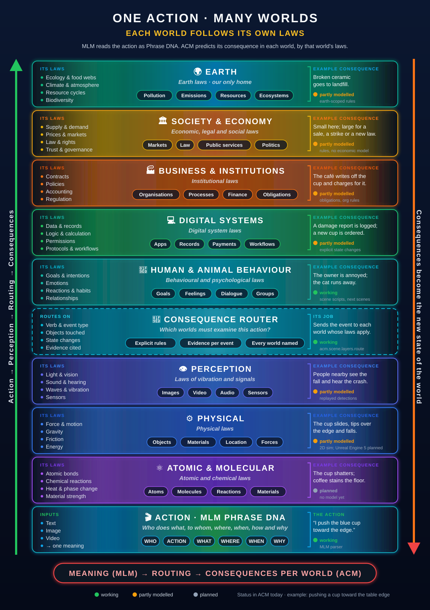
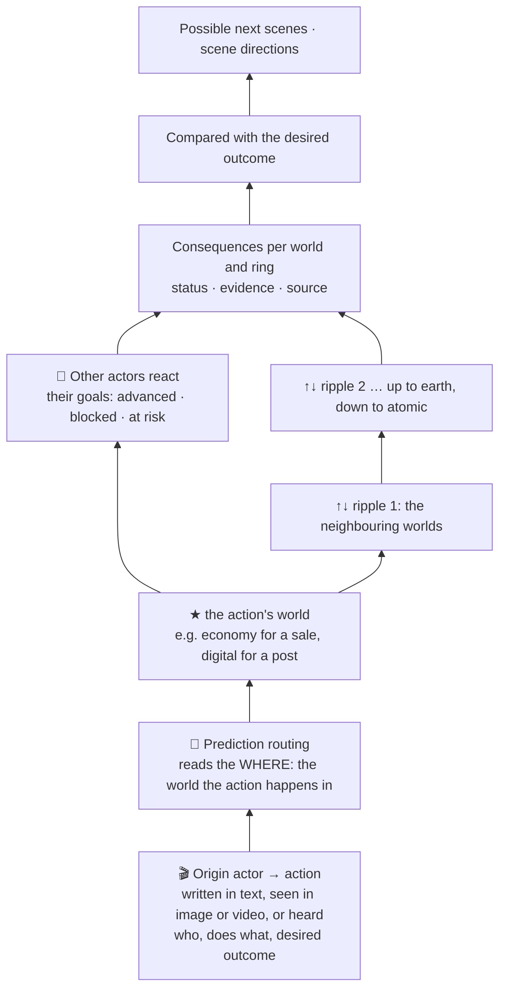

#  The Butterfly Model: the Action–Worlds Consequence prediction Model (ACM)

[← ⚡ 30-second version](README.md) · **📖 3-minute full version**

**1 actor · 1 action = consequences in cascade. See what an action changes before taking it.**

*The butterfly is for the butterfly effect. In code, the package, command and routes are `acm`.*

| | |
|---|---|
| [**What**](#what) | a model of what an action *does*, across eight worlds, each with its own laws |
| [**Why**](#why) | an LLM predicts words, not world states, and cannot show why it says what it says |
| [**How**](#how) | actor → action → routing by its WHERE → consequences cascade world by world; two engines; run it |
| [**So what**](#so-what) | explicit, inspectable, repeatable consequences that say when they do not know |
| [**What next**](#what-next) | a real model behind every world; [build it with us](#build-it-with-us); limitations; how to extend |

---

## What

A language model predicts the next word. [MLM, the Meaning Language Model](https://github.com/Sherlock2019/NPLM-Next-Phrase-language-model-),
first works out what a sentence means. **ACM predicts what an action does:** what it changes,
for whom, in which worlds, and how far it reaches.

One origin actor performs one action. The action happens in one world (its **WHERE**), and its
consequences spread from there to the other worlds. **Each world follows its own laws**, and
ACM predicts the consequence in each world by those laws.

<p align="center">
  
</p>

| World | Its laws | In ACM today |
|---|---|---|
| 🌍 Earth (planetary) | ecology, climate, resource cycles, biodiversity | partly: earth-scoped impact rules; no ecosystem model |
| 🏛️ Society & economy | economic, legal and social laws | partly: society and country impact rules; no economic or political model |
| 🏭 Business & institutions | contracts, policies, accounting, regulation | partly: obligations in scenes, organisation impact rules |
| 💻 Digital systems | data, logic, permissions, protocols, workflows | partly: explicit state changes and amounts |
| 🧠 Human & animal behaviour | behavioural and psychological laws | working: scene scripts, goals, next scenes |
| 👁️ Perception | vibration and signals: light, sound, sensing | partly: who sees or hears each event; image/video detections are replayed |
| ⚙️ Physical | force, motion, gravity, friction, energy | partly: positions, holders, owners; a 2D physics lab; Unreal Engine 5 planned |
| ⚛️ Atomic & molecular | atomic and chemical laws | planned (inside the physical layer in code); the physics lab applies a fracture rule |
| 🧭 Prediction routing | none: picks the worlds whose laws apply | working: `acm.scene.layers.route` |
| 🎬 Action | the cause: actor, goal, action, as Phrase DNA | working: MLM parser and scene scripts |

Every consequence sits on **two axes**: its **world** (which laws judge it) and its **ring**
(how far it reaches, from the actor and the other participants out to the city, society, the
economy and the earth).

[](docs/acm-vision.svg)

**[⛶ Open the radar full screen](docs/acm-vision.svg)** (animated). The origin actor (red) acts,
the other actors (blue) react, and the impact spreads outward world by world from the action's
own world (here the economy). Drawn from a real run by [`scripts/draw_vision.py`](scripts/draw_vision.py);
which world each consequence sits in is a mapping for the picture, since the rule engine
assigns rings, not worlds.

When the actor is **"I"**, the report is the model's view of its own planned action: a check an
agent can run before it acts.

---

## Why

An LLM continues text. An agent that acts needs to know what its actions **change**:

| LLM limitation | What goes wrong |
|---|---|
| **Words, not world states** | Nothing records that the car now belongs to Sarah, so the next sentence can give it to Mark. |
| **Fluent is not grounded** | A plausible answer and a correct one look the same; it cannot point at the rule behind a claim. |
| **No "I don't know"** | A missing cause becomes an invented one; an unknown verb still gets a confident verdict. |
| **Not repeatable** | Three samples of one prompt can disagree about who ends up with the car. |
| **No physics, one undifferentiated view** | Whether a pushed mug falls is never simulated; people, records, institutions and the planet are all just text. |
| **The view stops at the people mentioned** | Neighbours, organisations, the country and the earth appear only if the text names them. |

A real recording (SmolLM2-135M, local; [`examples/llm_baseline.json`](examples/llm_baseline.json)):

> *Mark wants to buy John's car. Sarah needs a car. John sold his car to Sarah.* **What happens next to Mark?**
>
> LLM: *"Mark buys a car."* · *"Mark gets a car."* · *"Mary bought a car. Mary sold a car to Mark."*
>
> ACM: **Mark's goal is BLOCKED ❌.** SALE makes `has(Sarah, car)` true; ownership is exclusive,
> so `has(Mark, car)` cannot hold. Sarah's goal is ADVANCED ✅. Basis: rule, certainty 1.0.

Larger models fail less often, but in the same way, and the failure is harder to spot.

---

## How



1. **The action, as data.** It arrives as text, an image, a video or audio. MLM turns a sentence
   into Phrase DNA (who · does what · to whom · where · when · why); a scene is a script
   (`acm.scene/1`) with actors, goals, objects and ordered events.
2. **Routing by the WHERE.** The action's WHERE names its world: throw a ball *in the park*
   (physical), post *on Facebook* or send an email (digital), buy *at a shop* (economy), vote
   *at the polls* or protest *in the street* (politics, in society). *Routing by the WHERE is
   the design; today the router decides from each event's verb, type, objects and effects
   ([rules below](#the-scene-engine)).*
3. **Each world predicts by its own laws.** Effects update the state event by event (in the car
   sale, the sale ends *disputed*, the car is still Sarah's, the debt unpaid); perception tracks
   who saw or heard what; the other worlds apply their rules.
4. **Other actors react.** Each actor's goal is checked against the predicted state: advanced,
   enabled, blocked, at risk or hindered.
5. **The cascade.** A consequence in one world affects its neighbours **by proximity**: the cup
   falls, people hear the crash, the owner is annoyed, a report is logged. Worlds can also change
   together (**synchronicity**), which counts as correlation, never cause. *Design, not built yet:
   ACM reports consequences per world but does not yet pass them from one world to the next.*
6. **Compared with the desired outcome, then next scenes.** Branches continue the scene under
   stated assumptions (authored, or from a local model, validated and labelled) and can be
   exported as `acm.directions/1`.

A local LLM only **phrases** ACM's results and reads free-form questions; it never decides a
consequence. Two engines share this model:

| Engine | Input | Output | Where |
|---|---|---|---|
| **Scene engine** | a situation as a script: people, goals, objects, actions, dialogue | state after every event, routing to the worlds, consequences per world and ring, next scenes, scene directions | [`src/acm/scene/`](src/acm/scene/), [`scenes/`](scenes/), dashboard `/acm/scenario` |
| **Rule engine** | one action sentence + context sentences | MLM parse → state changes → other actors' goals → the blast radius from YAML rule packs → a graph with vectors | [`src/acm/engine.py`](src/acm/engine.py), [`packs/`](packs/), dashboard `/acm` |

### The scene engine

A scene is a **script**: where and when, who is there (relationships, goals, what they know),
objects and who owns or holds them, and ordered actions and dialogue. The engine computes the
state after every event, routes each event to the worlds, shows consequences per world and ring,
offers next scenes, and exports the chosen one as `acm.directions/1` for the 2D player now and
3D, physics and text-to-speech later.

| Scene | Origin actor → action | WHERE |
|---|---|---|
| [`car_sale`](scenes/car_sale.yaml) | Mark offers Sarah's car to Florence to settle a €5,000 debt | economy |
| [`iphone_gift`](scenes/iphone_gift.yaml) | Mark offers Sarah an iPhone 18 bought on a 24-month plan | economy |
| [`beach_post`](scenes/beach_post.yaml) | Sarah posts a photo of Mark on Facebook on his sick day | digital |
| [`park_ball`](scenes/park_ball.yaml) | Leo throws a ball in the park; a window breaks | physical |
| [`factory_protest`](scenes/factory_protest.yaml) | Florence joins a street protest against a chemical factory | politics |
| [`ev_purchase`](scenes/ev_purchase.yaml) | Karim buys an electric car on a loan | economy |
| [`job_loss`](scenes/job_loss.yaml) | Claire, Mark's manager, lays him off | business |
| [`lottery_win`](scenes/lottery_win.yaml) | Sarah tells Mark she won €1 million | economy |

Each scene has consequences in every world and ring and at least two next scenes. Open one at
`/acm/scenario?scene=<id>`; sections A–F cover the overview, the 2D player with voice, actors,
world layers, the consequence radius and next scenes.

**Provenance on every item:**

| Label | Meaning |
|---|---|
| `scenario_fact` | given by the scenario |
| `authored_demo` | written for the demo: dialogue, analysis, branches (not model output) |
| `generated_inference` | from the local model, validated, not verified |
| `stated` · `possible` · `unknown` · `not_identified` | supported by cited events · plausible · not established · nothing found (never "no impact") |

Thoughts and feelings exist only as inferences; the schema rejects an inference marked `stated`.

**The router's rules today** (each route lists the rules that fired):

| Rule | Routed to |
|---|---|
| a physical verb (move, hold, offer, place, take, gesture), a physical object, or a change of position or holder | physical |
| every event: speech is heard, actions are seen | perception |
| dialogue, an action aimed at a person, or someone else's property | human and social |
| a change to an owned object, or an obligation | digital |
| an obligation (debt, agreement) | business |
| a consequence at a world cites the event | that world |

**Generated branches.** `ModelProvider` asks the local LLM (Ollama, `qwen2.5:7b` by default;
`ACM_LLM_URL` / `ACM_LLM_MODEL`) for more next scenes. The reply is validated against the scene:
unknown people or objects are rejected, unknown verbs dropped, and generated events never change
the state. If the model is down, the API returns 503 and the dashboard says why; the command line
falls back to the authored branches and says so. Nothing has a probability.

### The rule engine

> **"I will sell my car to Sarah in Paris tomorrow to pay my debt."** · Context: *"Mark wants to buy my car." "Sarah needs a car."*

| | Ring | What ACM finds |
|---|---|---|
| who | **Self** (I) | loses my car · gains money · own goal *pay my debt*: **ENABLED ➕** |
| who | **Impacted** (Sarah) | gains my car · loses money |
| who | **Other actors** | Mark wants to buy my car: **BLOCKED ❌** · Sarah wants a car: **ADVANCED ✅** |
| where | **Local** (Paris) | the sale takes place here |
| where | **Neighbours** (Boulogne-Billancourt, Saint-Denis, Montreuil) | no known impact |
| where | **Organisation** (city council, regional council, businesses) | insurers and the registry must record the new owner ● |
| where | **City** (Paris) | no known impact |
| where | **Country** (France) | a taxable transaction counts in national activity ● |
| where | **Society** | money circulates through the economy ● |
| where | **Earth** | an existing car is reused instead of a new one being made ▲ |

"No known impact" means no rule matched, never that there is no impact. No linguistic or world
facts live in Python; all of it is YAML under [`packs/`](packs/):

| Step | What it does | Knowledge |
|---|---|---|
| 1. Phrase DNA | MLM frames nest: *to pay my debt* becomes its own frame, inheriting the actor | MLM language packs |
| 2. Concepts | *sell*, *vendre*, *bán* → `SALE`; a concept names its roles, effects and requirements; 18 concepts | [`concepts.yaml`](packs/universal/concepts.yaml), `packs/<lang>/actions.yaml` |
| 3. State changes | written in a small vocabulary (`has`, `at`, `exists`, `owes`, `knows`, `won`, `damaged` …); exclusive states (one owner, one place, one winner) reveal conflicts | [`states.yaml`](packs/universal/states.yaml) |
| 4. Other actors | context sentences become goals in the same states, then are compared with the action's state changes | concept `requires`, exclusivity |
| 5. Blast radius | the gazetteer names each ring's extent (an unknown place is reported "not known", never guessed); impact rules name what the action does there | [`places.yaml`](packs/universal/places.yaml), [`impacts.yaml`](packs/universal/impacts.yaml), `categories.yaml` |
| 6. Graph + vectors | one graph per action; every node carries an 83-dim **structural** vector (kind, role, entity type, ring, lemma hash, certainty/tense): *John sold his car to Sarah* ≈ *He sold it to Sarah*, but *car* ≠ *vehicle* | MLM role inventory |
| 7. Vector DB | SQLite, exact cosine search: `similar_actions`, `history(entity)`, `search(kind=...)`; FAISS or pgvector later behind the same methods | [`store.py`](src/acm/store.py) |

### Multimodal input and the physical world

The same scene can arrive as text, an image or a video; each is first converted into MLM's
shared meaning, then into ACM's consequences. In the demo, image and video extractions are
hand-authored **replays** matched to synthetic media and labelled so everywhere; a video
prediction at T = 2 s uses earlier frames only, then is scored against what happened. Details:
[docs/multimodal.md](docs/multimodal.md) and [docs/world_model_feasibility.md](docs/world_model_feasibility.md).

**The physics lab** (`/acm/scene`, mockup) recognises the objects (detector mocked), gives them
library properties (mass, shape, material, friction, fragility), simulates the action in a 2D
matter.js engine, and shows **1 actor · 1 action = consequences in cascade**: routed by the WHERE
to the physical world, then simulated events (physical), fracture-rule events (atomic), inferred
impacts (perception), and the worlds not modelled in the lab, each labelled.

**Proposed: Unreal Engine 5** behind the same `TransitionPredictor` interface
([`src/acm/world/interface.py`](src/acm/world/interface.py)): **Chaos Physics** simulates the
action, **Physical Materials** take the object library's properties, and **Sequencer + Movie
Render Queue** render the predicted frames for comparison with reality. Simulated events become
consequences with the basis `simulation`. *Not integrated yet.*

### Run it

ACM needs MLM in the same Python environment. Clone both side by side:

```bash
git clone git@github.com:Sherlock2019/NPLM-Next-Phrase-language-model-.git SLM
git clone git@github.com:Sherlock2019/ACM.git
cd ACM
./start.sh            # creates .venv, installs MLM + ACM, writes demo data, starts API + dashboard
# http://127.0.0.1:3010/   (on EC2 the launcher prints the public address; open TCP 3010, keep 8001 closed)
./start.sh stop | status | restart | update | test | cli | predict "..." | demo
```

Manual install: `python -m venv .venv && source .venv/bin/activate && pip install -e ../SLM -e ".[dev]"`.
To analyse new text, also install MLM's parser: `pip install -e "../SLM[parse]"` and
`python ../SLM/scripts/download_resources.py`.

| Page | What it shows |
|---|---|
| `/` (also `/acm/home`) | the introduction |
| `/acm/tour` | four chapters with real outputs, including ACM next to a real local LLM |
| `/acm/inference` | 53 scenarios and 280+ "what happens next to …?" questions, each with its reasoning |
| `/acm` | the rule-engine demo: a phrase, an image and a video, each with its blast radius and a chat |
| `/acm/scenario` | the scene engine, with a picker for the [eight scenes](#the-scene-engine) |
| `/acm/scene` | the physics lab (mockup): recognise objects, simulate an action, see the consequences cascade |
| `/multimodal`, `/mlm` | MLM's multimodal demo and playground |

```bash
acm predict "I will sell my car to Sarah in Paris tomorrow to pay my debt." \
    --context "Mark wants to buy my car." --context "Sarah needs a car."   # --format text|mermaid|json
acm graph "..."        # the action graph as Mermaid
acm remember "..."     # store it in the graph vector DB;  acm similar "..." finds the nearest
acm scene list | validate | show | analyze | layers | route | branches | select | export | bundle
acm demo               # multimodal demo + docs/demo/tabletop_report.html
pytest                 # 106 tests (33 for the scene engine), committed fixtures, no GPU or network
```

---

## So what

| | LLM mode | ACM |
|---|---|---|
| Output | the next likely words | explicit state changes: `has(Sarah, car) = true` |
| Why | hidden in the weights | every consequence carries its rule, evidence and source |
| Unknowns | filled with plausible text | reported: "not identified" is never "no impact" |
| Other people's goals | often forgotten | checked one by one |
| Reach | whoever the text mentions | eight worlds × eight rings |
| Repeatability | varies with sampling | same input, same report |
| Changing what it knows | retrain | edit a YAML scene or pack |

**Where an LLM is still better:** breadth, fluency, and an answer for any unseen situation. That
is why ACM keeps one to phrase answers and propose next scenes, but never to decide.

**Honesty rules**, enforced in code and tests:

- **An unknown verb gets no verdict:** generic consequences, and *no evidence* for every goal.
- **No rule is not no impact;** an unknown place is *not known*, never guessed.
- **Negation and conditions count:** a negated action changes nothing; a conditional one has lower certainty (×0.6).
- **Certainty is reported;** an unnamed participant is never assumed ("John sold his car" puts Mark's goal *at risk*, not *blocked*).
- **Observed, proposed and predicted never merge:** every consequence carries its basis (`rule`, `simulation`, `observation`) and its source.
- **No future leakage:** a prediction for time T only sees what is known by T.
- **Vectors are described as what they are:** structural, not semantic.

---

## What next

A real model behind each world, measured against today's rules (status: [the world table](#what)):

| World | Next |
|---|---|
| ⚙️ Physical (+ atomic) | Unreal Engine 5 in the loop; world models (V-JEPA 2-AC) behind the same interface |
| 👁️ Perception | a vision-language model (Qwen3-VL) and a detector/tracker (YOLO) |
| 🧭 Routing | routing by the WHERE; a routing benchmark on annotated scenes |
| 🧠 Behaviour | model-generated analysis, validated like branches |
| 💻 Digital | sandboxed models of real systems (registries, ledgers, permissions) |
| 🏭 Business | process, contract and jurisdiction rule packs |
| 🏛️ Society & economy | economic and political models, labelled with their uncertainty |
| 🌍 Earth | resource and emission models |

Across all worlds: the cascade itself (worlds passing consequences to their neighbours until
nothing changes, certainty dropping at each hop), bigger knowledge packs, and learned components
that must beat the rule baseline.

### Build it with us

The architecture, the meaning layer, the scene engine and the first worlds are in place. To
finish the Butterfly Model, we are looking for **top AI talent** to work together:

| Help needed | On which world |
|---|---|
| Physics simulation: Unreal Engine 5 (Chaos), world models (V-JEPA 2-AC) | ⚙️ physical, ⚛️ atomic |
| Computer vision: vision-language models, detection and tracking | 👁️ perception |
| Agents, behaviour modelling, LLM evaluation | 🧠 behaviour, 🧭 routing |
| Digital twins of real systems: registries, ledgers, permissions | 💻 digital, 🏭 business |
| Economic, political, climate and resource modelling | 🏛️ society & economy, 🌍 earth |

**Let's work together:**
- Profile and projects: **[dzoannguyentran.jobsmatchnow.com](https://dzoannguyentran.jobsmatchnow.com/#projects)**
- WhatsApp: **[+84 908 618 075](https://wa.me/84908618075)**

**Limitations today**

- **Seed knowledge:** 18 concepts; 49 English, 24 French and 17 Vietnamese verbs; 42 impact rules; 18 gazetteer places. Anything else falls back to generic consequences or "not known".
- **Scenes are authored:** their analysis and branches are demo content; the model adds branches only.
- **Most worlds are rules, not models.**
- **Coarse text identity:** "John's car" and "his car" match, but so would two different cars.
- **No vision model run, no 3D physics yet:** replays and a 2D stand-in, labelled as such.
- **MLM's parse errors propagate** (French *à Sarah* is read as a location); explanations are English only.

**Extending ACM**

- **A verb:** `lemma: CONCEPT` in `packs/<lang>/actions.yaml`.
- **A concept:** roles, effects and requires in `packs/universal/concepts.yaml` (the loader rejects unknown states and roles).
- **An impact:** a rule in `packs/universal/impacts.yaml` with its ring as `scope`, plus words in `packs/<lang>/categories.yaml`.
- **A place:** an entry in `packs/universal/places.yaml` with `kind`, `neighbours`, `organization`, `city`, `country`.
- **A language:** `packs/<lang>/actions.yaml` and `categories.yaml` (MLM must support it).
- **A scene:** write `scenes/<id>.yaml` ([schema](src/acm/scene/schema.py); verbs: `move`, `hold`, `offer`, `place`, `take`, `speak`, `pause`, `gesture`), run `acm scene validate <id>`, then `acm scene bundle <id> -o ../SLM/web/public/demo/scene_<id>.json` (or `./start.sh`), and add it to the picker in the dashboard's `app/acm/scenario/page.tsx`.
- **A learned embedder:** `embed(**features) -> list[float]` with a `dim`, passed as `ConsequenceEngine(embedder=...)`.

**Project layout**

```
start.sh, dash.sh   launcher (dash.sh is an alias)
scenes/             eight scene scripts (acm.scene/1)
packs/              universal: states, concepts, impacts, places; <lang>: actions, categories
src/acm/            engine, entities, graph, store, render, cli, multimodal, inference, ask, llm
src/acm/scene/      scene engine: schema, validate, state, layers (router), providers, directions
src/acm/world/      transition interface, tabletop simulator, PyBullet / V-JEPA stubs
scripts/            draw_vision, make_fixtures, make_inference_suite, make_llm_baseline
examples/           inference suite (53 scenarios), recorded LLM baseline
docs/               logo, world-layers and radar diagrams, multimodal.md, world_model_feasibility.md
tests/              committed fixtures, no GPU or network
```

---

Copyright © 2026 Dzoan Nguyen Tran (dzoanNguyentran@gmail.com). Released under the
[MIT licence](LICENSE). MLM is a separate project under its own MIT licence.
