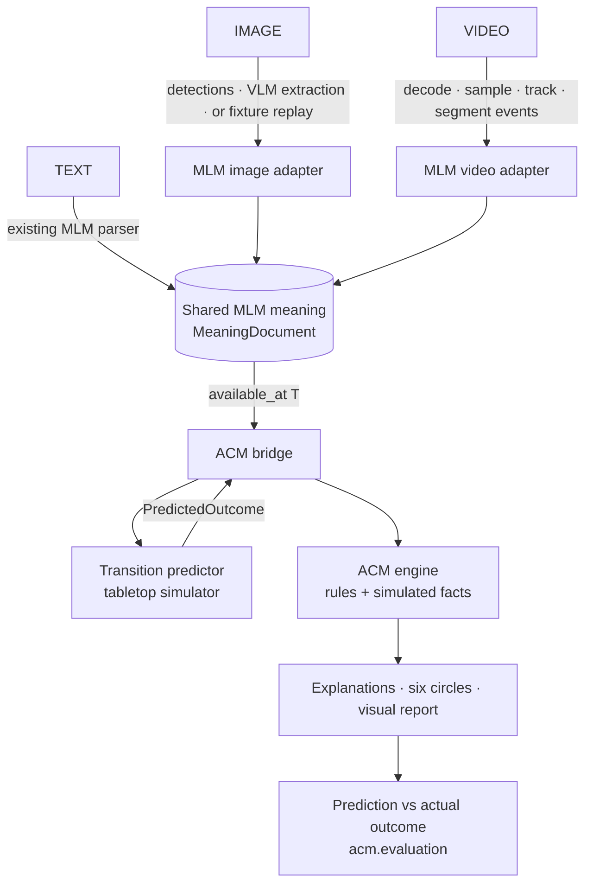

# Multimodal: text, image and video → MLM → ACM



**MLM is the common meaning layer. ACM is the consequence layer.** A vision model
never sends prose to ACM. Images and video are extracted into MLM's schema: entities
with stable ids, observations with evidence, a state timeline, and events in MLM's
semantic roles. That meaning goes to ACM as Universal Phrase DNA frames plus structured
facts. Nothing is rendered to text and parsed back.

## What is implemented and what is planned

| Piece | Status | Where |
|---|---|---|
| Shared schemas: evidence, entities, observations, scene state, events, proposed actions, predicted outcomes, goals, comparisons | **implemented** | `splm/meaning/schema.py` (MLM repo) |
| Coordinate frames: pixel / normalized / calibrated world, metric lengths, plane homography | **implemented** | `splm/meaning/geometry.py` |
| Meaning → frames without prose (`event_to_frame`, `action_to_frame`) | **implemented** | `splm/meaning/frames.py` |
| Text adapter on the existing parser; plans kept as goals, never as events | **implemented** | `splm/meaning/adapters/text.py` |
| Image adapter: validation, id reconciliation, rejecting unsupported claims | **implemented** (fixture replay) | `splm/meaning/adapters/image.py` |
| Video adapter: timeline, track association, event dedup, causal attribution, limits | **implemented** (fixture replay) | `splm/meaning/adapters/video.py` |
| Qwen3-VL through an OpenAI-compatible endpoint | **client implemented, not exercised** (no endpoint here) | `splm/meaning/adapters/models.py` |
| Ultralytics YOLO + tracker | **client implemented, not exercised** (no weights here) | `splm/meaning/adapters/models.py` |
| Deterministic tabletop simulator behind a transition interface | **implemented** | `acm/world/tabletop.py` |
| ACM bridge with leakage guard; pack-driven mapping of predicted changes | **implemented** | `acm/multimodal.py`, `packs/universal/simulation.yaml` |
| Tabletop concepts and states (PUSH, FALL, DROP; supported, fallen, displaced, collided, held) | **implemented** | `packs/universal/*.yaml` |
| Outcome evaluation and per-split episode store | **implemented** | `acm/evaluation.py` |
| Self-contained HTML report | **implemented** | `acm/visual_report.py` |
| Interactive dashboard page (Demo / Live) | **implemented** | MLM repo: `web/src/app/multimodal` |
| PyBullet physics | **planned** - interface raises `BackendUnavailable` | `acm/world/unavailable.py` |
| V-JEPA 2-AC world model | **research interface only** | [world_model_feasibility.md](world_model_feasibility.md) |

## The kinds of information, kept apart

| Kind | Type | Example | Never becomes |
|---|---|---|---|
| Entities | `SceneEntity` | `blue_cup_01`, `red_cup_01`: two cups, two ids | merged because they share the class `cup` |
| Observed states | `Observation` (`observed` / `inferred`) | `near_edge(blue_cup_01, table_01, right)` | an event |
| Observed events | `MeaningEvent` | video: `push` 2.0–3.0 s, AGENT `pusher_01` | a proposal or a prediction (the validator refuses `predicted` events) |
| Proposed actions | `ProposedAction` | push `blue_cup_01`, `direction_deg=0`, `distance=0.20 m` | an observation |
| Predicted outcomes | `PredictedOutcome` | `crosses_edge`, `falls`; landing position *unknown* | a fact about the world |
| Goals | `Goal` (`stated` / `supplied` / `inferred`) | text: "I plan to push..." | an invented purpose: a missing PURPOSE stays missing |

`MeaningDocument` keeps them in separate lists.

**Evidence differs by input, and it is not forced to agree.**
- **The image shows a scene.** "Someone pushed the cup", "intends to knock it over" and
  "belongs to the person" are moved to `rejected_claims`, each with its reason.
- **The video shows events.** A change between frames is not a cause, so the `fall`
  carries `causal_attribution="uncertain"`.
- **The text states a plan.** The positions used for it are labelled **assumed**.

## Coordinates and identity

- **Coordinate frames.** `image_pixel` (px), `image_normalized` (0–1) and `world`
  (m/cm/mm) are different frames. A world point needs the `calibration_id` that
  produced it.
- **Calibration.** The only way from an image frame to the world frame is a
  `Calibration`, a plane homography. It declares whether a box's centre (top-down
  view) or bottom-centre (camera view) touches the plane.
- **Off the plane.** A cup that has fallen off the table plane has *no* world position.
  The calibration does not cover the floor.
- **Tracker ids.** These are local to a `tracking_session`. Entity ids come from an
  explicit association table, or from first appearance within the session.

## No future leakage

`MeaningDocument.available_at(T)` drops every state after T, every event that ends
after T, and every prediction. `check_no_leakage` refuses a history containing a state
later than the action's decision time. In the bundled video, the push runs from 2.0 to
3.0 s, so a prediction at T = 2.0 s sees no events at all. The later frames are used
only by `compare_outcome`.

## Uncertainty is not one number

| Kind | Where it is kept |
|---|---|
| Detection confidence | `Observation.detection_confidence` |
| Interpretation uncertainty | `Observation.interpretation_confidence`, `MeaningEvent.causal_attribution`, `hypothesis` |
| Prediction uncertainty | `UncertaintyReport.prediction` ("deterministic rule output; no probability is estimated") |
| Rule applicability | `UncertaintyReport.rule_applicability` |
| Simulation assumptions | `PredictedOutcome.assumptions` (each with value, unit, reason) and `unknowns` |
| ACM rule certainty | `Consequence.certainty` - a rule weight, **not a calibrated probability** |

## The tabletop simulator

It is a constrained, deterministic, 2-D kinematic rule set. It is **not** general
physical understanding.

- **Push.** The object slides exactly the requested distance (an assumption, recorded
  with its unit) and stops at contact with another footprint. It reports `collides`,
  plus an unknown: how the hit object moves.
- **Fall rule.** When the centre of mass (assumed at the footprint centre) ends beyond
  the support boundary, the object `crosses_edge` and `falls`. If only part of the
  footprint is over the edge, it `overhangs_edge` and stays supported.
- **What it never says.** Where a fallen object lands, whether it breaks, whether it
  spills. Force, friction, mass, material, table height and contents are listed as
  unknowns every time.
- **Branching.** Alternatives (no action, push toward the edge, move toward the centre)
  branch from one deep-copied initial state, which is never modified.

## How the consequences come out in ACM

Push toward the edge, from any of the three inputs:

| Circle | Consequence | Basis |
|---|---|---|
| Actor | text: own goal "push the blue cup toward the right edge" **advanced**; image/video: no supporting evidence | rule |
| Impacted | `blue_cup_01` is moved from where it was | rule (PUSH) |
| Impacted | loses the support of `table_01`; is now on `floor_01`; falls | **simulation** |
| Impacted | damage **unknown** (needs material, fall height, impact surface); spill **unknown** (contents unspecified) | `simulation.yaml` |
| Other actors | no supporting evidence | - |
| Environment | `table_01` no longer supports `blue_cup_01`; `floor_01 (assumed)`: it arrives | simulation |
| Society, Earth, wider layers | **no supporting evidence** - no rule matched, which is not "no impact" | - |

Ownership cannot come from proximity, and damage needs a rule or model that has the
required information. Neither is predicted here.

## Run it

```bash
# ACM: the end-to-end demo (fixture replay + simulator + ACM), with a self-contained report
python -m acm.cli demo --report docs/demo/tabletop_report.html --json /tmp/demo.json
./start.sh demo                     # the same, through the launcher

# MLM: regenerate the demo materials (SVGs, extraction fixtures, MP4/WebM)
python scripts/make_tabletop_demo.py           # needs headless Chromium + ffmpeg for the video
python scripts/make_tabletop_demo.py --no-video

# Refresh the dashboard's bundled results after changing ACM or MLM
python -m acm.cli demo --json ../SLM/web/public/demo/demo_results.json

# The interactive page
cd ../SLM && ./start.sh            # then open http://127.0.0.1:3010/multimodal
```

On EC2, `./scripts/ec2_service.sh install` in the MLM repo serves the same page at
`http://EC2-PUBLIC-IP:3010/multimodal`. Demo mode needs nothing beyond the built
dashboard. Live text also needs ACM installed in MLM's venv (the installer does this
when `../ACM` or `SPLM_ACM_DIR` exists) and the Stanza model.

## Model configuration and hardware

Nothing is downloaded automatically. Default tests and the demo need no GPU and no
network.

| Backend | Configure | Verified facts (official sources, 2026-10-26) |
|---|---|---|
| Qwen3-VL | `SPLM_VLM_ENDPOINT`, `SPLM_VLM_MODEL` (default `Qwen/Qwen3-VL-8B-Instruct`), `SPLM_VLM_API_KEY` | Apache-2.0; about 9B parameters (BF16); image and video input; served with `vllm serve Qwen/Qwen3-VL-8B-Instruct` (port 8000) or SGLang (30000) at `/v1/chat/completions`. The model card gives **no VRAM figure**: measure on your GPU. |
| Ultralytics YOLO | `SPLM_YOLO_WEIGHTS` (default `yolo26n.pt`, must already exist); tracker `bytetrack.yaml` or `botsort.yaml` | Licence **AGPL-3.0 or Enterprise**: check before shipping. `model.track(frame, persist=True)`. Detection and tracking only; it predicts no consequences. |
| Video decoding | `pip install 'splm[vision]'` (opencv-python-headless, ultralytics) | - |
| PyBullet | `pip install 'acm[physics]'` | not integrated: needs mass, friction, force and table height, which the scene schema has no source for |
| V-JEPA 2-AC | - | see [world_model_feasibility.md](world_model_feasibility.md) |

**Models actually exercised in this repository:** the MLM phrase builder (on
hand-written trees) and the Stanza parser (live text, when installed). Qwen, YOLO,
PyBullet and V-JEPA were **not** run.

## Evaluation results

One synthetic, scripted episode (`demo-video-push-01`, split `eval`). The prediction is
made at T = 2.0 s and compared with the observed state at 4.0 s:

| Metric | Value |
|---|---|
| Fall events | TP 1, FP 0, FN 0 → precision 1.0, recall 1.0 |
| Support-state accuracy | 1.0 (2 objects) |
| Position error | 0.0 m (n = 1, `red_cup_01`) |
| Abstentions | 1 (`blue_cup_01` landing position), consistent with the observation, which cannot place it either |

These numbers show that the workflow runs. They say nothing about real-world accuracy:
the outcome was scripted with the same rule the simulator uses.

Latency on this machine (CPU): building the three meaning documents takes 133 ms; one
simulator prediction takes 0.25 ms; simulation plus ACM takes 1.3 ms per alternative.

## Tests

- **ACM** (`tests/test_multimodal.py`):
  - simulator outcomes: fall, overhang, collision;
  - refusals: missing parameters, pixel-only positions, wrong calibration;
  - immutable branching and future leakage;
  - unavailable backends;
  - ACM mapping with basis labels, kept separate for two objects of the same class;
  - text vs video consistency, evaluation, the episode store and the report.
- **MLM** (`tests/test_meaning.py`):
  - coordinate frames and units, entity identity and schema validators;
  - image claim rejection, replay misuse and malformed responses;
  - the video timeline, dedup and causal attribution, and the leakage cut;
  - text plans with purpose left unknown, and text/video role compatibility;
  - live backends failing clearly.
- **Dashboard:** `node web/scripts/check-tabletop.mts` checks that the browser simulator
  matches the Python simulator on all 9 bundled branches.

## Limitations

- The image and video extractions in the demo are **hand-authored replays** matched to
  synthetic media. No vision model has been run.
- The text demo uses hand-written parse trees in Demo mode. Live text uses the real
  parser, but positions are still assumed: text gives no geometry.
- The simulator covers rigid discs on one rectangular table, with three actions. It
  does not model friction, force, tipping, bouncing, rolling or stacking.
- The evaluation is one scripted episode. There is no real-world measurement yet.
- The dashboard does not wire Live image or video. The Python adapters support it once
  an endpoint and weights are configured.
- Nothing here learns from stored episodes. Storing an episode does not improve
  anything.
